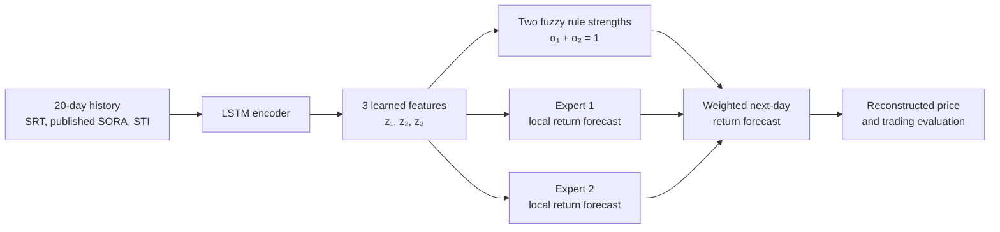

# Review Draft: LSTM-Encoded Fuzzy Local Experts for Singapore S-REIT Forecasting

**Working title:** An LSTM-Encoded Fuzzy Mixture of Local Experts for Singapore S-REIT Return Forecasting  
**Status:** Revised design, 3 November 2026. The team reports instructor approval of the architecture; the saved data have been audited. [Experimental protocol v1.2](experiment_protocol_lstm_fuzzy_local_experts.md) fixes the implementation details before learned-model training.

## 1. Research question

Can a compact LSTM learn a useful **three-dimensional representation** of recent Singapore REIT and market history, so that a small fuzzy system can combine two local return predictors more effectively than an ordinary LSTM prediction head?

This is the team's proposed direction: the fuzzy system acts **after the LSTM encoder**. It does not modify the LSTM's internal forget or input gates. The local predictors estimate next-day returns; a separate, transparent trading rule can use those forecasts in the evaluation.

The design is inspired by the [Fuzzformer paper](https://arxiv.org/html/2510.00960v1), which uses an LSTM, attention, low-dimensional representations and fuzzy local models for multi-horizon stock-index forecasting. Our course version uses **no attention**, **one next-day prediction**, **two simple local linear experts**, and a different Singapore REIT target. It does not attempt to reproduce the paper's ARIX local models or its full clustering objective.

## 2. Prediction target and dataset

The primary target is the **SGD counter of the CSOP iEdge S-REIT Leaders Index ETF (`SRT.SI`)**. SRT is a listed ETF tracking the iEdge S-REIT Leaders Index; an ETF transaction price should not be called an index level. The saved 28 October 2026 source snapshot produces **1,182 valid 20-day forecast windows** from January 2022 to September 2026. The 2025-10-24 close was repaired from a documented second source; its open remains missing. The primary label is the **raw closing-price log return**, and cash distributions are excluded from the primary forecast target.

| Source | Core information available by the forecast time | Role |
| --- | --- | --- |
| SRT | Lagged daily log return, five-day momentum and trailing 20-return volatility | Target history and REIT-specific context |
| MAS SORA | Latest **published** value and its approximately 20-business-day change | Interest-rate environment |
| STI | Lagged daily return | Broad Singapore equity-market conditions |

The **one core dataset** is the daily alignment of these sources on SRT trading dates. We will compare `SRT only`, `SRT + SORA`, and `SRT + SORA + STI`, so each added series must show incremental value rather than being included merely because it is available. HSI is excluded from the core proposal because its link to this Singapore REIT ETF is less direct. An additional REIT-market series can be explored only after the core experiment works and data quality permits.

At the **close of Singapore trading day `t`**, the model uses only information already public and predicts SRT's `t+1` **raw closing-price log return**:

```text
y_t = log(C_(t+1) / C_t)
predicted C_(t+1) = C_t × exp(predicted y_t)
```

This reconstruction is the log-return counterpart of predicting a price difference and adding it to today's price. The unchanged-price reference predicts `y_t=0`, hence `predicted C_(t+1)=C_t`. For trading, use executable raw opens and explicitly label results **price-only and dividend-excluded** until all distributions can be verified; never use a retrospectively adjusted price as a transaction quote.

MAS releases each business day's SORA on the **following** business day. We will align it by publication time, not by the date to which the rate refers. Thus the forecast made after the close of `t` cannot use an unreleased SORA for `t`. All rolling features and input windows are similarly backward-looking.

The saved SRT history is short and contains no 2020 COVID crash. This limits claims about rare regimes, but supports a small, forward-tested course model. A different ETF would be a separately approved extension, not an unannounced fallback in the primary experiment.

## 3. Proposed architecture

For a forecast after day `t`, let `X_t` contain the most recent `L = 20` trading-day feature vectors. The same historical input is given to each learned baseline. The LSTM encodes the window into a hidden state, and a small projection compresses it to three learned features:

```text
h_t = LSTM_encoder(X_t)                   # e.g., 32 hidden units
z_t = tanh(W_z h_t + b_z) ∈ R³            # three learned fuzzy inputs
```

The three coordinates are **learned features, not hand-named economic variables**. The fuzzy system sees only `z_t`, not a flattened `20 days × number of raw variables` vector.



### Two fuzzy rules

Use two three-dimensional Gaussian memberships, each with a trainable center `μ_k` and positive diagonal scale `s_k`:

```text
d_k(z_t) = Σ_(j=1..3) [ (z_tj - μ_kj) / s_kj ]²
m_k(z_t) = exp(-0.5 × d_k(z_t))
α_k(z_t) = m_k(z_t) / [m_1(z_t) + m_2(z_t)]     for k ∈ {1, 2}
```

The normalized rule strengths are nonnegative and sum to one. In code, compute `α = softmax(-0.5 × [d_1, d_2])` to avoid numerical underflow. `tanh` bounds the learned features; positive, bounded scales keep membership calculations well behaved. We will initialize the two centers to different small values so that the rules do not begin as exact copies. The centers and scales are learned jointly with the encoder and local predictors.

### Two small local experts

Each expert is initially an **affine return predictor**, not another full LSTM:

```text
e_k(z_t) = a_kᵀ z_t + c_k
ŷ_t = α_1(z_t) × e_1(z_t) + α_2(z_t) × e_2(z_t)
```

The resulting system is a compact two-rule Takagi–Sugeno style fuzzy predictor. The fuzzy layer softly mixes the experts; it does not make an irreversible all-or-nothing choice. The experts predict next-day return, and one common signal rule maps the combined return forecast to a long/cash trading action. Training separate buy/sell policies would require a different objective and is outside the core course design.

We will initially call these **Expert 1** and **Expert 2**. Labels such as “strong market expert” or “crash expert” must be earned by checking when each rule activates and how its local forecast behaves. In particular, SRT was listed after the 2020 COVID market crash, so its own price history cannot train an expert on that specific episode.

## 4. Training and validation

- Start with one LSTM layer, 32 hidden units, a three-unit projection, two fuzzy rules, and two affine experts. The model and optimizer settings are fixed in protocol v1.2; development validation may guide only changes recorded before final testing.
- Train the encoder, projection, fuzzy memberships and expert coefficients **jointly** against next-day return mean squared error. Use the protocol's **AdamW** (`0.001` learning rate, `0.0001` weight decay), chronological early stopping and three fixed seeds for model comparison.
- Fit input and target scalers on each fold's **training portion only**, then apply them unchanged to that fold's validation/test observations. Align SORA by its actual publication time before building windows. Treat holidays and missing observations consistently across all models.
- Before training, plot **pretest** raw close and log return side by side, their rolling mean/standard deviation, the return distribution and missing-price dates. Returns can be closer to stationary without being fully stationary; changing volatility remains a limitation.
- Use the saved chronological expanding splits: training through March 2024 → 126 validation targets in April–September 2024; through September 2024 → 124 targets in October 2024–March 2025; through March 2025 → 128 targets in April–September 2025. After fixing model and policy settings, refit on the 931 pretest windows and evaluate once on the untouched **251-target October 2025–September 2026** holdout. The inner stopping set comes only from each fold's training rows.
- Track average rule weights and expert prediction differences. If one expert receives nearly all weight or both experts make essentially identical predictions, report that the desired specialization did not emerge. Do not assign favorable regime names merely because the model has two experts.

The audited sample has **1,182 forecast windows**. It is enough for a small course experiment, but not evidence that the three-dimensional representation or two specialists will generalize across long market cycles. A recent CPU laptop with 8 GB RAM should be adequate for the proposed small models; a short pilot will establish actual runtime before the full three-seed comparison.

## 5. Benchmarks and experiments

| Model or experiment | Purpose |
| --- | --- |
| Zero next-day return / unchanged price | Basic reference for noisy daily prices |
| Ordinary LSTM with a linear return head | Conventional machine-learning benchmark using identical inputs |
| LSTM → three features → linear return head | Tests whether the narrow representation alone explains any change |
| LSTM → three features → fuzzy two-expert head | Proposed hybrid method |
| Source ablation: SRT; +SORA; +STI | Tests whether each external source adds value |

All learned models use identical time splits, input availability and forecast labels. The three-feature linear control is especially important: comparing only the fuzzy model with a full-width LSTM would mix the effect of the fuzzy head with the effect of compressing the representation.

`Fuzzy2` versus `LSTM3` tests the **whole two-rule head**, including its extra expert; it cannot isolate Gaussian membership benefits. A priority secondary control, if run before the final test, is `Gate2`: the same encoder, projection and two affine experts with a `3→2 tanh→2 softmax` gate (14 gate parameters versus 12 Gaussian center/scale parameters). It adds nine development runs and tests a similarly small learned gate, not every possible non-fuzzy mixture. If it is omitted, describe a `Fuzzy2` gain only as a gain of this TSK head over the linear head. For two Gaussian rules, `α₁=sigmoid((d₂−d₁)/2)`; equal rule widths make this logit affine, explaining why the fuzzy and ordinary-gate function classes overlap.

Before batch ablations, upgrade the export interface: every trained prediction row uses the key `(model_id, source_group, rule_count, fold, seed, window_id)`. Use `rule_count=0` for non-fuzzy controls, `2` for `Fuzzy2`, and `3` for `Fuzzy3`; migrate the existing six-column `Z0` baseline explicitly. Save fuzzy case diagnostics under the same key with `z1,z2,z3,y_mix_raw`, and save per-rule details in a **long table** with one `rule_id,alpha,expert_raw,log_membership,distance2` row per rule. Reject duplicates, missing rule rows, nonfinite weights, and any mismatch between weighted expert outputs and the prediction file. The current evaluation code and Notebook handoff still use the older six-column format; this is an implementation gate, not a completed capability.

Report return MAE/RMSE, reconstructed-price MAE/RMSE and directional accuracy for each validation window and the final test. The zero-return predictor (`ŷ=0`) is the **unchanged-close** forecast baseline. The forecast is converted back to SGD price with `Ĉ_(t+1)=C_t exp(ŷ_t)` before its price error is compared with that baseline.

For trading, calculate a long/cash signal **after close `t`** and execute it at the **next open**. The untuned primary rule holds SRT when the raw-return forecast is positive. A genuinely model-free comparison applies the same rule to the past-only signal `five-day SRT log momentum / 5`; always-long and always-cash remain fixed references. Every strategy uses the same eligible open-to-open intervals and 10-bps primary one-way position-change cost, with 0/20-bps sensitivities. Start wealth at `V_0=1`, update `V_(i+1)=V_i(1+r_i^net)`, plot the wealth path, and compare **terminal wealth multiple** as well as drawdown and turnover. A larger final wealth multiple from model predictions is a hypothesis to test, not an outcome to assume.

A secondary threshold study uses `θ∈{0,0.001,0.002,0.003}` on both model forecasts and daily-scaled momentum. Choose thresholds solely from the three **pretest development folds**, using their compounded terminal wealth at 10 bps; freeze them before the final holdout. Wealth on those same development folds is selection evidence and must not be presented as an unbiased profit estimate. The fixed `θ=0` result remains visible. Forecasts target **close-to-close** returns whereas trading earns **next-open to following-open** returns; inspect their development-period relationship and explain any mismatch. Do not change the primary target after seeing test profits.

The missing **2025-10-24 open** cannot trigger an exit at the previous open merely because the backtest later discovers a missing quote. First seek an independently verifiable replacement and rerun the source audit. If none is available before the final configuration freeze, the predeclared fallback is **no trade at an unobserved open, carry existing cash/shares to the next observed open, then use the latest already-known signal**. Apply the same observed-open calendar to every strategy; always-long remains invested across the gap. Label this a constrained-data simulation, since the market did trade on that day. A common-complete-interval segmented view is only a sensitivity and is not continuous buy-and-hold. The causal observed-open ledger is now implemented and tested on a synthetic missing-open gap. For the horizon check, compare **true close return, predicted close return and realized open-to-open return** on development dates; an overnight move before entry can make a correct forecast untradable.

SRT's cash distributions can change strategy rankings when holdings differ across ex-dates. All nine events are now checked against issuer/exchange records; report gross-distribution and price-only paths separately, without treating gross receipts as universal after-tax wealth. Entitlement follows shares held before the ex-date; record a receivable on the ex-date, transfer it to cash on the payment date, and do not automatically reinvest until a policy-directed purchase. The ledger uses gross SGD distributions; after-tax receipts depend on investor category, and the missing 2025-10-24 open still constrains any final-period simulation.

## 6. What can actually be interpreted

The model exposes three useful intermediate objects: the latent vector `z_t`, each rule's weight `α_k(t)`, and each expert's local forecast `e_k(z_t)`. Plot them through time and compare rule activation with **externally defined** market summaries such as prior trend and realized volatility. Examine whether the experts differ in errors or signals across these conditions and whether the patterns repeat across random seeds.

Write each latent-space rule explicitly: **`IF z₁∈A_k1 AND z₂∈A_k2 AND z₃∈A_k3, THEN return=e_k(z)=a_kᵀz+c_k`**. The Gaussian antecedent memberships multiply to raw strength `m_k`; normalized `α_k` mixes the affine Takagi–Sugeno consequents. Each one-dimensional Gaussian peaks at one and has convex alpha-cuts, but learned centers are not constrained to form ordered linguistic terms or cover the latent domain. Save `log m_k` and squared distances as well as `α_k`, because `α₁+α₂=1` can hold even when both raw memberships are tiny. Compare the largest raw membership with training-derived low-coverage thresholds and report rule overlap/collapse.

For each rule, define a high-activation region by that rule's upper-quartile weight on **training** predictions; apply the frozen cut to evaluation dates. Report the region's sample count and compare that rule's standalone raw-return MAE with the other expert and the mixture **on the same dates**. A stronger local-specialist claim needs the activated expert to beat the other there repeatedly across folds and seeds. Also report the fixed `α_k>0.8` count and align swapped rule identities across seeds. Past volatility/momentum bins use training-period terciles. These are acceptance checks, not a new loss or a reason to rename an expert after seeing favorable test examples.

The latent coordinates may rotate, swap roles or mix several economic effects during training. Two Gaussian rules do **not** by themselves prove that the model has discovered “bull” and “recession” states. Takagi–Sugeno affine consequents are also less linguistically transparent than plain verbal consequents. The defensible interpretation is narrower: which learned local expert contributed to a particular forecast, and whether its activation has a stable relationship with observed market conditions. If that relationship is absent, describe the model as a traceable latent-feature mixture rather than an interpretable market-regime classifier.

The combination is integrated: LSTM features enter both fuzzy rule memberships and local consequents, and the encoder, memberships and experts are optimized jointly. It is therefore distinct from averaging predictions from a separately trained LSTM and a separately trained fuzzy system. The course lecture warns that the phrase “Fuzzy LSTM” alone does not specify an architecture; our diagrams and equations, with the cited Fuzzformer inspiration, specify exactly what is implemented.

The reference paper also uses attention, separate antecedent/consequent representations, ARIX consequents, winner-takes-all local training and clustering/separation objectives. Our simpler global-MSE, affine-expert model omits mechanisms intended to encourage local quality and distinct clusters. It must earn any specialization claim from the checks above; the paper's results on a different index and multi-step task cannot be transferred to this ETF. [Fuzzformer Methods II-B/II-C](https://arxiv.org/html/2510.00960v1).

## 7. Teacher's project guidance: fit and feasibility

In the opening project segment of the Week 11 lecture, the instructor emphasized examining the series, putting later observations in the test set, tuning only on earlier data, avoiding direct absolute-price prediction, comparing against an unchanged-price predictor, and checking whether forecasts improve **final multiplicative portfolio wealth** over a no-prediction trading approach. Later in the lecture, he stressed that “Fuzzy LSTM” names several possible architectures and that combining two independent outputs at the end is an ensemble, not automatically the intended hybrid. The table separates requirements already specified in this design from work still to implement.

| Lecture point | Fit of the present design | Implementation and feasibility |
| --- | --- | --- |
| Examine data; use chronological train/test; tune before testing | Saved expanding folds and train-only scaling satisfy the timing rule. | Add the pretest price/return and rolling-statistic plots before model training; preserve the final holdout for one evaluation. |
| Predict changes or returns; compare reconstructed price with unchanged price | Raw next-day log return is the target; `C_t exp(ŷ_t)` reconstructs price; `Z0` predicts unchanged close. | The scoring code already computes return and price errors. A log return is not guaranteed stationary, so show its changing volatility. |
| Prediction quality and trading wealth are different questions | The design specifies next-open positions, costs, model-free controls, causal missing-quote handling and conditional dividend accounting. | Replace the future-aware legacy ledger, add wealth paths and `V_T`, freeze thresholds on pretest folds, and test the close/open horizon mismatch. |
| Define a genuine neuro-fuzzy mechanism and justify the paper adaptation | Learned LSTM features enter the Gaussian antecedents and affine experts, trained jointly; `LSTM32` and `LSTM3` isolate the added head. | The implementation must confirm gradients reach both components. Latent rules are only conditionally interpretable after activation checks against observed past-only states. |
| Choose data suitable for the claim | The audited SRT/SORA/STI alignment gives 1,182 windows and a tradable REIT ETF target. | Five years cannot establish crash-era specialization; one open is missing and dividends are unverified for total-return claims. Report price-only trading until verified. |

This is feasible as a small, reproducible course experiment on a CPU laptop: the fixed plan entails **48 development runs × two fits each + nine final fits = 105 fits**, excluding optional `Gate2`, failed-run repeats and pilots. The one/two-rule diagnostic reuses existing runs. Actual elapsed time must be measured by the Phase 1 pilot rather than assumed. Whether fuzzy rules improve return RMSE or terminal wealth is unknown until the forward tests run. A negative result is still informative if the unchanged-price, ordinary-LSTM and model-free trading comparisons are completed and the limits are reported honestly.

The course proposal allows **at most three PPT slides** and asks for one dataset with its type and period, an explained hybrid AI method, and a benchmark machine-learning method. The aligned SRT-centered dataset, LSTM-to-fuzzy architecture, and same-input ordinary LSTM meet that proposal structure. The instructors determine whether a submitted method/data combination conflicts with another group's proposal.

## 8. Evidence needed for the final course report

- **Method choices and contribution:** describe 20 trading days as roughly one market month, 32 hidden units as a small-capacity choice for 1,182 windows, three latent dimensions as a readable fuzzy input, and two rules as the smallest nontrivial mixture. These are design reasons, not proof of optimality; the `K=1/2/3` diagnostic and source ablations test parts of them. Simplifying Fuzzformer alone is not an empirical contribution.
- **Literature and result comparison:** expand the current chronological/taxonomy review with recent related methods and application areas. Compare Fuzzformer and this project by data, horizon, encoder, antecedents, local model, loss and reported accuracy/interpretability tradeoff. Discuss whether our *pattern of findings* agrees with the paper, while avoiding direct numeric RMSE ranking across unrelated datasets. The paper reports multi-horizon S&P 500 experiments and uses local/cluster objectives absent here. [Original paper](https://arxiv.org/html/2510.00960v1).
- **Theory and applications beyond the ETF:** formulate testable future questions: whether constrained latent features preserve linguistic rule meaning across seeds; whether local expert losses improve specialization without hurting global error; and how rule coverage changes under concept drift. A future application could be another noisy time series with observable states, but it would need its own timing and baseline study.
- **Submission consistency:** keep the already submitted three-slide proposal as a historical artifact. The final results slides and Notebook must describe AdamW, fixed distinct rule centers, no K-means/balance/separation loss in the primary run, the full **105-fit** core workload, version-2 diagnostic exports and any price-only versus total-wealth limit. Current slides and Notebook scaffold do not yet provide that final evidence.

## 9. Review finding closure map

| Audit finding | Design decision now fixed | Still to implement or verify |
| --- | --- | --- |
| F1 · Future-aware exit at missing open | Verify the open; otherwise no trade at that open and carry the existing position to the next observed quote. Segmented intervals are only a labelled sensitivity. | Replace the legacy ledger and test a deliberately introduced future missing quote. |
| F2 · Forecast/trade horizon mismatch | Retain the close-return primary target; compare true close return, forecast and realized trade return on development dates. | Add the aligned diagnostic; a trade-target extension requires a named pretest decision. |
| F3 · Weak rule semantics/local evidence | Report explicit latent TSK rules, raw membership coverage and same-region standalone expert errors. | Set training-derived cuts, validate case/rule diagnostics and refrain from regime names without stable evidence. |
| F4 · Fuzzy-specific attribution | Primary claim concerns the whole TSK head; `Gate2` is a specified, optional near-size control. | Decide before final testing whether nine extra development runs are feasible. |
| F5 · Dividend exclusion | Verify nine distributions and pre-ex-date entitlement; otherwise restrict trading claims to price-only wealth. | Source audit and receivable/payment-date ledger. |
| F6 · Diagnostic key collision | Version-2 full run key plus per-rule long table. | Upgrade scorer, Notebook and export tests before batch ablations. |
| F7 · Artifact and research-depth differences | AdamW and 105 fits are the source of truth; final report adds literature/result comparison and theoretical future work. | Rebuild final slides/Notebook from measured results; preserve old proposal as history. |

## References

- AI6124 lecture PDF in this workspace, *AI6124 - week 8 - Neural in Neuro-Fuzzy Systems.pdf*, especially slides 17 and 20–23.
- AI6124 Week 11, *Neuro-Fuzzy Systems and POPFNN*, opening project guidance on time splits, returns and multiplicative profits, plus the later discussion of Fuzzy LSTM architectures; checked against the lecture transcript supplied on 3 November 2026.
- Ožbot, Škrjanc & Štruc, [*A Neuro-Fuzzy System for Interpretable Long-Term Stock Market Forecasting*](https://arxiv.org/html/2510.00960v1), arXiv:2510.00960v1, 2025. The architecture and loss in this draft are deliberately simpler than the paper's.
- SGX, [CSOP iEdge S-REIT Leaders Index ETF prospectus](https://links.sgx.com/FileOpen/CSOP%20REIT%20ETF%20-%20Prospectus%202021.ashx?App=IPO&FileID=6314) (fund target and listing date).
- MAS, [SORA publication information](https://www.mas.gov.sg/monetary-policy/SORA) (following-business-day release).
- SGX, [Straits Times Index description](https://www.sgx.com/indices/products/sti) (broad local equity index).
