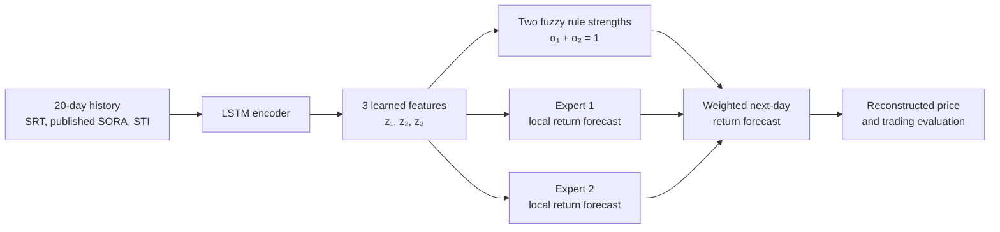

# Review Draft: LSTM-Encoded Fuzzy Local Experts for Singapore S-REIT Forecasting

**Working title:** An LSTM-Encoded Fuzzy Mixture of Local Experts for Singapore S-REIT Return Forecasting  
**Status:** Design for team review, 14 October 2026. Historical data quality and the final course proposal have not yet been confirmed.

## 1. Research question

Can a compact LSTM learn a useful **three-dimensional representation** of recent Singapore REIT and market history, so that a small fuzzy system can combine two local return predictors more effectively than an ordinary LSTM prediction head?

This is the team's proposed direction: the fuzzy system acts **after the LSTM encoder**. It does not modify the LSTM's internal forget or input gates. The local predictors estimate next-day returns; a separate, transparent trading rule can use those forecasts in the evaluation.

The design is inspired by the [Fuzzformer paper](https://arxiv.org/html/2510.00960v1), which uses an LSTM, attention, low-dimensional representations and fuzzy local models for multi-horizon stock-index forecasting. Our course version uses **no attention**, **one next-day prediction**, **two simple local linear experts**, and a different Singapore REIT target. It does not attempt to reproduce the paper's ARIX local models or its full clustering objective.

## 2. Prediction target and dataset

The primary target is the **SGD counter of the CSOP iEdge S-REIT Leaders Index ETF (SRT)**. SRT is a listed ETF tracking the iEdge S-REIT Leaders Index; an ETF transaction price should not be called an index level. The planned sample runs from its 18 November 2021 listing through 30 September 2026. The exact coverage, distribution adjustments and missing observations must be audited before model training.

| Source | Core information available by the forecast time | Role |
| --- | --- | --- |
| SRT | Lagged daily returns and trailing momentum/volatility; volume only if reliable | Target history and REIT-specific context |
| MAS SORA | Latest **published** value and its approximately 20-business-day change | Interest-rate environment |
| STI | Lagged daily return | Broad Singapore equity-market conditions |

The **one core dataset** is the daily alignment of these sources on SRT trading dates. We will compare `SRT only`, `SRT + SORA`, and `SRT + SORA + STI`, so each added series must show incremental value rather than being included merely because it is available. HSI is excluded from the core proposal because its link to this Singapore REIT ETF is less direct. An additional REIT-market series can be explored only after the core experiment works and data quality permits.

At the **close of Singapore trading day `t`**, the model uses only information already public and predicts SRT's `t+1` log return:

```text
y_t = log(P*_(t+1) / P*_t)
predicted P*_(t+1) = P*_t × exp(predicted y_t)
```

`P*` is a price series with an explicitly checked treatment of ETF distributions. If a reliable adjusted series is unavailable, we will forecast raw closing-price returns and treat cash distributions separately in investment returns. Trading results use executable raw prices and confirmed distributions, never a retrospectively adjusted price as a transaction quote.

MAS releases each business day's SORA on the **following** business day. We will align it by publication time, not by the date to which the rate refers. Thus the forecast made after the close of `t` cannot use an unreleased SORA for `t`. All rolling features and input windows are similarly backward-looking.

**Data fallback:** If SRT's daily price/distribution history is inadequate, consider CLR.SI, a longer-history Singapore REIT ETF that tracks a *different* index. Its use would require updating the target description and, after proposal submission, obtaining course approval for the change.

## 3. Proposed architecture

For a forecast after day `t`, let `X_t` contain the most recent `L = 20` trading-day feature vectors. The same historical input is given to each learned baseline. The LSTM encodes the window into a hidden state, and a small projection compresses it to three learned features:

```text
h_t = LSTM_encoder(X_t)                   # e.g., 32 hidden units
z_t = tanh(W_z h_t + b_z) ∈ R³            # three learned fuzzy inputs
```

The three coordinates are **learned features, not hand-named economic variables**. The fuzzy system sees only `z_t`, not a flattened `20 days × number of raw variables` vector.



### Two fuzzy rules

Use two three-dimensional Gaussian memberships, each with a trainable center `μ_k` and positive diagonal scale `s_k`:

```text
d_k(z_t) = Σ_(j=1..3) [ (z_tj - μ_kj) / s_kj ]²
m_k(z_t) = exp(-0.5 × d_k(z_t))
α_k(z_t) = m_k(z_t) / [m_1(z_t) + m_2(z_t)]     for k ∈ {1, 2}
```

The normalized rule strengths are nonnegative and sum to one. In code, compute `α = softmax(-0.5 × [d_1, d_2])` to avoid numerical underflow. `tanh` bounds the learned features; positive, bounded scales keep membership calculations well behaved. We will initialize the two centers to different small values so that the rules do not begin as exact copies. The centers and scales are learned jointly with the encoder and local predictors.

### Two small local experts

Each expert is initially an **affine return predictor**, not another full LSTM:

```text
e_k(z_t) = a_kᵀ z_t + c_k
ŷ_t = α_1(z_t) × e_1(z_t) + α_2(z_t) × e_2(z_t)
```

The resulting system is a compact two-rule Takagi–Sugeno style fuzzy predictor. The fuzzy layer softly mixes the experts; it does not make an irreversible all-or-nothing choice. The experts predict next-day return, and one common signal rule maps the combined return forecast to a long/cash trading action. Training separate buy/sell policies would require a different objective and is outside the core course design.

We will initially call these **Expert 1** and **Expert 2**. Labels such as “strong market expert” or “crash expert” must be earned by checking when each rule activates and how its local forecast behaves. In particular, SRT was listed after the 2020 COVID market crash, so its own price history cannot train an expert on that specific episode.

## 4. Training and validation

- Start with one LSTM layer, 32 hidden units, a three-unit projection, two fuzzy rules, and two affine experts. These are small, predeclared defaults; adjust only a few hyperparameters using development validation windows.
- Train the encoder, projection, fuzzy memberships and expert coefficients **jointly** against next-day return mean squared error. Use Adam, moderate weight decay, early stopping and at least three random seeds for the final model comparison.
- Fit price-feature scalers and the target scaler on each training window only. Align SORA by its actual publication time before building windows. Treat holidays and missing observations consistently across all models.
- Use chronological expanding-window validation within the development period. A provisional schedule is: train through March 2024, validate April–September 2024; expand training through September 2024, validate October 2024–March 2025; expand training through March 2025, validate April–September 2025. After choosing the model, retrain using data available through September 2025 and evaluate once on the untouched **October 2025–September 2026** test period. Final dates depend on the audited trading calendar.
- Track average rule weights and expert prediction differences. If one expert receives nearly all weight or both experts make essentially identical predictions, report that the desired specialization did not emerge. Do not assign favorable regime names merely because the model has two experts.

The planned sample is only about **one thousand to twelve hundred daily observations**, before removing early rolling-window rows and missing observations. It is sufficient for a small course experiment, but it cannot guarantee that the learned three-dimensional representation or two specialists will generalize. A recent CPU laptop with 8 GB RAM should be adequate; a ten-epoch pilot will establish actual runtime before the full run.

## 5. Benchmarks and experiments

| Model or experiment | Purpose |
| --- | --- |
| Zero next-day return / unchanged price | Basic reference for noisy daily prices |
| Ordinary LSTM with a linear return head | Conventional machine-learning benchmark using identical inputs |
| LSTM → three features → linear return head | Tests whether the narrow representation alone explains any change |
| LSTM → three features → fuzzy two-expert head | Proposed hybrid method |
| Source ablation: SRT; +SORA; +STI | Tests whether each external source adds value |

All learned models use identical time splits, input availability and forecast labels. The three-feature linear control is especially important: comparing only the fuzzy model with a full-width LSTM would mix the effect of the fuzzy head with the effect of compressing the representation.

An optional stronger architecture control is a **non-fuzzy learned softmax gate with the same two affine experts**. This would test whether Gaussian fuzzy memberships offer value beyond a general two-expert mixture. It is a secondary analysis after the required benchmark and source ablations.

Report return MAE/RMSE, reconstructed-price MAE/RMSE and directional accuracy for each validation window and the final test. For the trading exercise, create the signal after `t` closes and execute no earlier than the `t+1` open. Compare a long/cash strategy with buy-and-hold and the course's no-prediction baseline; include trading costs, turnover, cumulative return and maximum drawdown. A better forecast score is not assumed to imply a better trading result.

## 6. What can actually be interpreted

The model exposes three useful intermediate objects: the latent vector `z_t`, each rule's weight `α_k(t)`, and each expert's local forecast `e_k(z_t)`. Plot them through time and compare rule activation with **externally defined** market summaries such as prior trend and realized volatility. Examine whether the experts differ in errors or signals across these conditions and whether the patterns repeat across random seeds.

The latent coordinates may rotate, swap roles or mix several economic effects during training. Two Gaussian rules do **not** by themselves prove that the model has discovered “bull” and “recession” states. The defensible interpretation is narrower: which learned local expert contributed to a particular forecast, and whether its activation has a stable relationship with observed market conditions. This limit should appear in any eventual proposal or results presentation.

## 7. Fit with the AI6124 proposal

The course proposal allows **at most three PPT slides** and asks for one dataset with its type and period, an explained hybrid AI method, and a benchmark machine-learning method. This document now defines all three: one aligned SRT-centered daily dataset, an LSTM encoder followed by a two-rule fuzzy mixture of local experts, and a same-input ordinary LSTM benchmark. It also defines a testable data-source ablation and chronological validation.

The practical contribution is a transparent, compact adaptation of a published architecture to a Singapore REIT ETF, with a different prediction horizon and carefully timed interest-rate data. It is a proposed course experiment, not an empirical claim of improved accuracy or a claim that no other group has a similar idea. The instructors determine whether the submitted method/data combination conflicts with another group's proposal.

## References

- AI6124 lecture PDF in this workspace, *AI6124 - week 8 - Neural in Neuro-Fuzzy Systems.pdf*, especially slides 17 and 20–23.
- Ožbot, Škrjanc & Štruc, [*A Neuro-Fuzzy System for Interpretable Long-Term Stock Market Forecasting*](https://arxiv.org/html/2510.00960v1), arXiv:2510.00960v1, 2025. The architecture and loss in this draft are deliberately simpler than the paper's.
- SGX, [CSOP iEdge S-REIT Leaders Index ETF prospectus](https://links.sgx.com/FileOpen/CSOP%20REIT%20ETF%20-%20Prospectus%202021.ashx?App=IPO&FileID=6314) (fund target and listing date).
- MAS, [SORA publication information](https://www.mas.gov.sg/monetary-policy/SORA) (following-business-day release).
- SGX, [Straits Times Index description](https://www.sgx.com/indices/products/sti) (broad local equity index).
