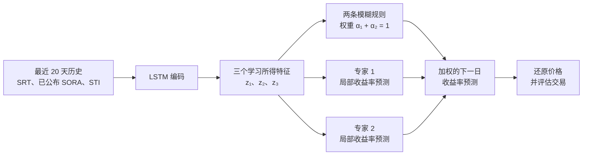

# 审阅稿：LSTM 编码与模糊局部专家的新加坡 REIT 预测方案

**建议英文题目：** *An LSTM-Encoded Fuzzy Mixture of Local Experts for Singapore S-REIT Return Forecasting*  
**状态：** 2026-10-14 的团队讨论稿；历史数据尚未完整下载、检查，方案也尚未获授课教师批准。

## 1. 研究问题与架构定位

研究问题：**LSTM 能否从近期新加坡 REIT 与市场序列中学习三个有用的压缩特征，让一个小型模糊系统组合两个局部预测模型，并优于普通 LSTM 的下一交易日预测？**

这版采用你们讨论的新路线：**LSTM 先提取特征，Fuzzy 位于 LSTM 之后**。它与此前“模糊规则进入 LSTM 遗忘门和输入门”的方案是两个不同的模型；此处不再改动 LSTM 内部门控。两个局部专家首先负责预测下一日收益率，之后统一用预测结果生成交易信号。

该想法借鉴 [Fuzzformer 论文](https://arxiv.org/html/2510.00960v1)中“神经网络压缩多变量历史，再由模糊局部模型预测”的结构。课程版省去注意力模块，改为下一日单步预测、三维潜在特征、两条模糊规则和两个小型线性专家；不声称复现论文中的 ARIX 专家或完整聚类损失。

## 2. 数据、预测目标与时间点

主目标是 **CSOP iEdge S-REIT Leaders Index ETF 的新加坡元柜台 SRT**。它是跟踪 iEdge S-REIT Leaders Index 的可交易 ETF；预测的是 ETF 价格相关的收益率，不直接预测指数点位。计划数据期为 2021 年 11 月 18 日上市后至 2026 年 9 月 30 日，具体覆盖情况需要审计。

| 来源 | 主方案特征 | 为什么加入 |
| --- | --- | --- |
| SRT | 过去日收益率、动量、波动率；成交量仅在数据可靠时加入 | 目标自身历史及 REIT 状态 |
| MAS SORA | 截至预测时已公布的利率、约 20 个工作日变化 | 新加坡利率环境 |
| STI | 过去日收益率 | 新加坡整体股市信息 |

提案中的**一组数据集**由以上来源按 SRT 交易日和实际信息发布时间对齐。输入消融按 `仅 SRT → +SORA → +STI` 进行，让每项外部数据证明其增量价值。HSI 与本地 REIT 的关联理由较弱，暂不进入主方案；其他 REIT 数据可作为主实验完成后的扩展。

统一预测时点为新加坡交易日 `t` **收盘后**，目标是 `t+1` 的对数收益率及由此还原的价格：

```text
y_t = log(P*_(t+1) / P*_t)
预测价格 P*_(t+1) = P*_t × exp(预测收益率)
```

`P*` 的分红调整口径必须核查。若可靠的复权数据不可得，则预测原始收盘价收益率，并在投资组合回测中单独计入已确认的现金分红；不能把事后复权价格当作成交价。MAS 在某工作日的**下一个工作日**才公布该日 SORA，因此 `t` 收盘预测时只能使用当时已经发布的数值。滚动指标、缺失值处理和标准化也必须遵守这一时间界线。

如果 SRT 历史价格与分红记录不足，备选目标为历史较长的 **CLR.SI**；它跟踪另一只 REIT 指数，改目标时必须同步修改题目和数据描述。若提案已提交，还需按课程规定申请教师批准。

## 3. 具体模型：三维特征、两条模糊规则、两个专家

对每次预测，模型读取截至 `t` 的最近 `L=20` 个交易日特征序列 `X_t`。一层 LSTM 将历史压缩为隐藏状态，再用小型投影得到**三个由数据学习的特征**：

```text
h_t = LSTM(X_t)                         # 初始方案：32 个隐藏单元
z_t = tanh(W_z h_t + b_z) ∈ R³          # Fuzzy 每次只接收 3 个数
```

`z₁、z₂、z₃` 并不预先命名为趋势、风险、利率。模糊系统只接收当前三维 `z_t`，**不会把“20 天 × 每天多个原始变量”展开成一个巨大输入**。



### 模糊层

对 `z_t` 设置两个三维高斯模糊集合。每条规则有可训练中心 `μ_k` 和正的逐维宽度 `s_k`：

```text
d_k(z_t) = Σ_(j=1..3) [ (z_tj - μ_kj) / s_kj ]²
m_k(z_t) = exp(-0.5 × d_k(z_t))
α_k(z_t) = m_k(z_t) / [m_1(z_t) + m_2(z_t)]，k = 1, 2
```

两个权重非负、总和为 1。实现时用 `α = softmax(-0.5 × [d_1, d_2])` 计算，避免指数值过小造成数值问题。`tanh` 限定特征范围，正且有界的 `s_k` 避免异常窄或宽的模糊集合。两个中心从略有区别的初值开始，随后连同 LSTM 一起训练。

### 局部专家与最终预测

主方案中的专家是**两个小型仿射预测器**，各自输出下一日收益率，而非再建两个完整 LSTM：

```text
e_k(z_t) = a_kᵀ z_t + c_k
ŷ_t = α_1(z_t) × e_1(z_t) + α_2(z_t) × e_2(z_t)
```

这相当于一个紧凑的两规则 Takagi–Sugeno 风格预测头。模糊系统以软权重混合两个专家，不必硬性选择其中之一。专家负责预测，统一的 long/cash 策略再把预测收益率转换为交易动作。若直接训练两个“买卖策略专家”，需要重新定义交易目标和训练损失，因此不纳入此次核心课程方案。

训练前只称为**专家 1、专家 2**。只有检查激活时期、局部预测表现和市场状态之后，才能判断它们是否真分别偏向强势／疲弱市场。SRT 在 2021 年 11 月才上市，**其自身价格历史不包含 2020 年 COVID 崩盘**，不能据此宣称训练出了针对那次崩盘的专家。

## 4. 训练与时间验证

- 初始模型固定为：20 日输入、一层 32 维 LSTM、三维投影、两条高斯规则、两个线性专家。少量超参数只在开发期验证窗口调整。
- 使用下一日收益率的均方误差、Adam、适度权重衰减及早停，**联合训练** LSTM、投影层、模糊中心／宽度和专家系数。最终模型比较至少重复三个随机种子。
- 每一折的标准化器仅在该折训练区间拟合；SORA 先按公布时间对齐，再构建输入窗口。
- 在开发期做扩展窗口验证。暂定：训练至 2024-03、验证 2024-04 至 2024-09；扩展训练至 2024-09、验证 2024-10 至 2025-03；扩展训练至 2025-03、验证 2025-04 至 2025-09。选定方案后用截至 2025-09 的可用数据重新训练，最后仅在 **2025-10 至 2026-09** 的保留测试期评估一次。最终日期以交易日覆盖率审计为准。
- 检查两条规则的平均权重与两个专家的预测差异。如果一条规则几乎独占所有样本，或者两个专家预测几乎一样，就如实报告“未形成明显专业分工”，不能只凭结构命名市场状态。

预计只有约 **1,000–1,200 个日频观察值**，滚动窗口和缺失值处理后更少。它可支持一个紧凑的课程实验，却不能保证三维特征或双专家具有稳定的样本外表现。普通 8 GB 内存的近期 CPU 笔记本应足够；先跑十个 epoch 的短测试确定真实训练时间。

## 5. 公平对照、消融与评价

| 对照 | 回答的问题 |
| --- | --- |
| 零收益率／价格不变预测 | 是否超过简单参考 |
| 普通 LSTM + 线性预测头 | 相同输入下，混合模型是否优于常规机器学习基准 |
| LSTM → 三维特征 → 线性预测头 | 改进是否仅来自三维压缩 |
| LSTM → 三维特征 → 两规则／双专家预测头 | 完整主方案 |
| `仅 SRT → +SORA → +STI` | 外部数据分别贡献了什么 |

所有可训练模型使用一致的预测时点、数据划分和输入信息。三维线性对照尤其重要，否则“模糊模型优于普通 LSTM”的结果可能其实来自表示压缩，无法归因于模糊专家。若主实验进展顺利，可追加**相同两个专家 + 普通神经网络 softmax 权重**，检验高斯模糊权重相对于一般双专家混合的独立贡献。

预测指标：下一日收益率 MAE／RMSE、还原价格 MAE／RMSE、方向准确率，按各验证窗口和最终测试期报告。交易评价：在 `t` 收盘后产生信号，最早于 `t+1` 开盘执行；将 long/cash 策略与买入持有、课堂无预测基准比较，报告交易成本、换手率、累计收益与最大回撤。预测误差改善不预设为交易绩效改善。

## 6. 可解释性与课程定位

可检查的量包括三维潜在特征 `z_t`、两条规则的激活权重 `α_k(t)`，以及两个专家各自的预测 `e_k(z_t)`。将其与**另外定义的**过去趋势、历史波动率等市场状态对照，检查专家是否确实在不同状态下发挥不同作用，以及这种模式是否跨随机种子稳定。

三维特征由模型学习，可能混合多种经济因素，也可能在不同训练中旋转或交换位置。**两条高斯规则并不能自动证明模型发现了“牛市／衰退”。**可靠的解释结论应限于：某时点哪些专家参与了预测、其激活与可观察市场状态之间是否存在稳定对应关系。

课程提案上限为三页 PPT，须说明**一组数据集及类型／时段、混合 AI 方法如何应用、benchmark 方法**。本设计已将这些内容具体化为：以 SRT 为目标的日频对齐数据、LSTM 后接双规则模糊局部专家、同输入普通 LSTM 对照，并附有严格的时序验证与数据源消融。最终提案是否与别组冲突，仍以授课教师审核为准。

## 参考资料

- 本目录课程课件 *AI6124 - week 8 - Neural in Neuro-Fuzzy Systems.pdf*，尤其第 17、20–23 页。
- Ožbot、Škrjanc、Štruc，[*A Neuro-Fuzzy System for Interpretable Long-Term Stock Market Forecasting*](https://arxiv.org/html/2510.00960v1)，2025。此处方案有意简化其架构与损失函数。
- SGX，[SRT ETF 招募说明书](https://links.sgx.com/FileOpen/CSOP%20REIT%20ETF%20-%20Prospectus%202021.ashx?App=IPO&FileID=6314)。
- MAS，[SORA 发布规则](https://www.mas.gov.sg/monetary-policy/SORA)。
- SGX，[STI 指数简介](https://www.sgx.com/indices/products/sti)。
