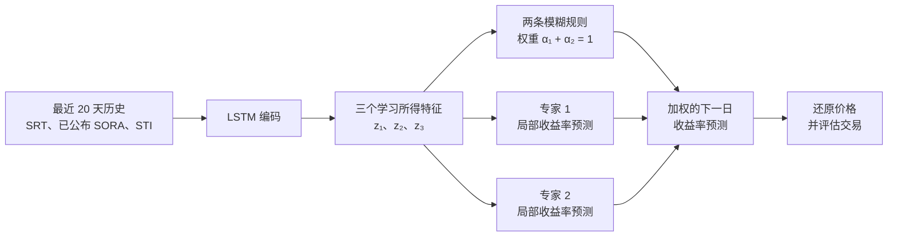

# 审阅稿：LSTM 编码与模糊局部专家的新加坡 REIT 预测方案

**建议英文题目：** *An LSTM-Encoded Fuzzy Mixture of Local Experts for Singapore S-REIT Return Forecasting*  
**状态：** 2026-11-03 修订稿。团队已确认教师批准当前架构，保存的数据也已审计；训练与评估细节以[实验协议 v1.2](experiment_protocol_lstm_fuzzy_local_experts.md)为准。

## 1. 研究问题与架构定位

研究问题：**LSTM 能否从近期新加坡 REIT 与市场序列中学习三个有用的压缩特征，让一个小型模糊系统组合两个局部预测模型，并优于普通 LSTM 的下一交易日预测？**

这版采用你们讨论的新路线：**LSTM 先提取特征，Fuzzy 位于 LSTM 之后**。它与此前“模糊规则进入 LSTM 遗忘门和输入门”的方案是两个不同的模型；此处不再改动 LSTM 内部门控。两个局部专家首先负责预测下一日收益率，之后统一用预测结果生成交易信号。

该想法借鉴 [Fuzzformer 论文](https://arxiv.org/html/2510.00960v1)中“神经网络压缩多变量历史，再由模糊局部模型预测”的结构。课程版省去注意力模块，改为下一日单步预测、三维潜在特征、两条模糊规则和两个小型线性专家；不声称复现论文中的 ARIX 专家或完整聚类损失。

## 2. 数据、预测目标与时间点

主目标是 **CSOP iEdge S-REIT Leaders Index ETF 的新加坡元柜台 `SRT.SI`**。它是跟踪 iEdge S-REIT Leaders Index 的可交易 ETF；预测的是 ETF 原始收盘价的收益率，不直接预测指数点位。已保存的 2026-10-28 数据快照形成 **1,182 个有效的 20 日预测窗口**，覆盖 2022 年 1 月至 2026 年 9 月。2025-10-24 的收盘价已用第二来源修复，但该日开盘价仍缺失。主标签不包含现金分红。

| 来源 | 主方案特征 | 为什么加入 |
| --- | --- | --- |
| SRT | 过去的日对数收益率、5 日动量、20 日滚动波动率 | 目标自身历史及 REIT 状态 |
| MAS SORA | 截至预测时已公布的利率、约 20 个工作日变化 | 新加坡利率环境 |
| STI | 过去日收益率 | 新加坡整体股市信息 |

提案中的**一组数据集**由以上来源按 SRT 交易日和实际信息发布时间对齐。输入消融按 `仅 SRT → +SORA → +STI` 进行，让每项外部数据证明其增量价值。HSI 与本地 REIT 的关联理由较弱，暂不进入主方案；其他 REIT 数据可作为主实验完成后的扩展。

统一预测时点为新加坡交易日 `t` **收盘后**，目标是 `t+1` 的**原始收盘价对数收益率**及由此还原的价格：

```text
y_t = log(C_(t+1) / C_t)
预测价格 C_(t+1) = C_t × exp(预测收益率)
```

这是“预测价格变化后还原价格”的对数收益率版本。零收益预测意味着 `预测 C_(t+1)=C_t`，正好对应老师强调的“明天价格等于今天”基线。回测使用可成交的原始开盘价；九个分红事件已与发行人资料核对；分别报告**不含分红的价格财富**与**含税前分红的财富**，不能把事后复权价格当作成交价。MAS 在某工作日的**下一个工作日**才公布该日 SORA，因此 `t` 收盘预测时只能使用当时已经发布的数值。

SRT 历史较短，且不包含 2020 年 COVID 崩盘；它适合小型、按时间向前验证的课程实验，但不支持“已学到崩盘专家”之类的结论。更换 ETF 属于另立的扩展方案，不能在主实验中悄悄替换目标。

## 3. 具体模型：三维特征、两条模糊规则、两个专家

对每次预测，模型读取截至 `t` 的最近 `L=20` 个交易日特征序列 `X_t`。一层 LSTM 将历史压缩为隐藏状态，再用小型投影得到**三个由数据学习的特征**：

```text
h_t = LSTM(X_t)                         # 初始方案：32 个隐藏单元
z_t = tanh(W_z h_t + b_z) ∈ R³          # Fuzzy 每次只接收 3 个数
```

`z₁、z₂、z₃` 并不预先命名为趋势、风险、利率。模糊系统只接收当前三维 `z_t`，**不会把“20 天 × 每天多个原始变量”展开成一个巨大输入**。



### 模糊层

对 `z_t` 设置两个三维高斯模糊集合。每条规则有可训练中心 `μ_k` 和正的逐维宽度 `s_k`：

```text
d_k(z_t) = Σ_(j=1..3) [ (z_tj - μ_kj) / s_kj ]²
m_k(z_t) = exp(-0.5 × d_k(z_t))
α_k(z_t) = m_k(z_t) / [m_1(z_t) + m_2(z_t)]，k = 1, 2
```

两个权重非负、总和为 1。实现时用 `α = softmax(-0.5 × [d_1, d_2])` 计算，避免指数值过小造成数值问题。`tanh` 限定特征范围，正且有界的 `s_k` 避免异常窄或宽的模糊集合。两个中心从略有区别的初值开始，随后连同 LSTM 一起训练。

### 局部专家与最终预测

主方案中的专家是**两个小型仿射预测器**，各自输出下一日收益率，而非再建两个完整 LSTM：

```text
e_k(z_t) = a_kᵀ z_t + c_k
ŷ_t = α_1(z_t) × e_1(z_t) + α_2(z_t) × e_2(z_t)
```

这相当于一个紧凑的两规则 Takagi–Sugeno 风格预测头。模糊系统以软权重混合两个专家，不必硬性选择其中之一。专家负责预测，统一的 long/cash 策略再把预测收益率转换为交易动作。若直接训练两个“买卖策略专家”，需要重新定义交易目标和训练损失，因此不纳入此次核心课程方案。

训练前只称为**专家 1、专家 2**。只有检查激活时期、局部预测表现和市场状态之后，才能判断它们是否真分别偏向强势／疲弱市场。SRT 在 2021 年 11 月才上市，**其自身价格历史不包含 2020 年 COVID 崩盘**，不能据此宣称训练出了针对那次崩盘的专家。

## 4. 训练与时间验证

- 初始模型固定为：20 日输入、一层 32 维 LSTM、三维投影、两条高斯规则、两个线性专家。具体优化器与训练设置以实验协议 v1.2 为准；若在开发期更改，须在最终测试前记录并冻结。
- 使用下一日收益率的均方误差和协议规定的 **AdamW**（学习率 `0.001`、权重衰减 `0.0001`），按时间顺序早停，**联合训练** LSTM、投影层、模糊中心／宽度和专家系数。正式比较采用三个固定随机种子。
- 每一折的标准化器仅在该折训练区间拟合；SORA 先按公布时间对齐，再构建输入窗口。
- 训练前只用**最终测试期之前的数据**画出原始收盘价与日对数收益率、滚动均值／标准差、收益率分布及缺失日期。收益率可能比价格水平更接近平稳，但波动率仍会变化，不能仅凭图表断言完全平稳。
- 使用已保存的扩展窗口划分：训练至 2024-03 → 验证期 126 个目标；训练至 2024-09 → 124 个目标；训练至 2025-03 → 128 个目标。模型和策略设置冻结后，用 931 个测试前窗口重训，最后只在 **2025-10 至 2026-09 的 251 个目标**上评估一次。每折的早停区间只能从该折训练数据末尾划出。
- 检查两条规则的平均权重与两个专家的预测差异。如果一条规则几乎独占所有样本，或者两个专家预测几乎一样，就如实报告“未形成明显专业分工”，不能只凭结构命名市场状态。

审计后的样本有 **1,182 个预测窗口**。它可支持紧凑的课程实验，却不足以保证三维特征或双专家跨长期市场周期稳定。普通 8 GB 内存的近期 CPU 笔记本应可运行这套小模型；先做短训练测量本机耗时，再执行三个随机种子的完整比较。

## 5. 公平对照、消融与评价

| 对照 | 回答的问题 |
| --- | --- |
| 零收益率／价格不变预测 | 是否超过简单参考 |
| 普通 LSTM + 线性预测头 | 相同输入下，混合模型是否优于常规机器学习基准 |
| LSTM → 三维特征 → 线性预测头 | 改进是否仅来自三维压缩 |
| LSTM → 三维特征 → 两规则／双专家预测头 | 完整主方案 |
| `仅 SRT → +SORA → +STI` | 外部数据分别贡献了什么 |

所有可训练模型使用一致的预测时点、数据划分和输入信息。三维线性对照尤其重要，否则“模糊模型优于普通 LSTM”的结果可能其实来自表示压缩，无法归因于模糊专家。但 `Fuzzy2` 相对 `LSTM3` 还同时增加了门控和第二个专家，不能仅凭获胜就把效果归因于“高斯模糊”。若有资源并在最终测试前预先确定，可增加 `Gate2`：相同编码器、三维投影和两个仿射专家，门控为 `3→2 tanh→2 softmax`（14 个门控参数，对照高斯中心／宽度的 12 个），开发期需额外 9 组运行。若不运行，只声称**整体 TSK 预测头**相对于线性头的表现。两规则下 `α₁=sigmoid((d₂−d₁)/2)`；两条规则宽度相同时，对数几率可化为 `z` 的仿射函数，说明两类门控并非完全不重叠。

批量消融须使用已升级的导出接口：每条预测用 `(model_id, source_group, rule_count, fold, seed, window_id)` 唯一标识。非模糊对照的 `rule_count=0`，`Fuzzy2` 为 2，`Fuzzy3` 为 3；历史六列 `Z0` 基线须明确迁移。模糊样本诊断在同一键下保存 `z1,z2,z3,y_mix_raw`；每条规则另用**长表**保存一行 `rule_id,alpha,expert_raw,log_membership,distance2`。检查重复键、缺失规则、非有限权重，以及加权专家输出与预测文件是否一致。七列导出、校验器和 Notebook 交接内容已经更新，批量训练仍须通过完整键检查。

预测指标：下一日收益率 MAE／RMSE、还原价格 MAE／RMSE、方向准确率，按各验证窗口和最终测试期报告。零收益预测 `ŷ=0` 是**价格不变**基线；先用 `预测 C_(t+1)=C_t exp(ŷ_t)` 还原价格，再与它比较价格误差。

交易评价在 `t` 收盘后产生信号，**最早于 `t+1` 开盘执行**。无需调参的主规则为“原始收益率预测 `ŷ_t>0` 则持有 SRT，否则持有现金”。无模型预测的动量对照把同一 long/cash 规则应用于当时已知的 `SRT 过去 5 日对数动量 / 5`；另列始终持有和始终持有现金。所有策略使用相同可成交区间，主要假设每次单向仓位变化成本为 10 个基点，另报告 0／20 个基点的敏感性。财富从 `V_0=1` 开始，按 `V_(i+1)=V_i(1+r_i^net)` 逐段复利；展示**完整财富曲线与期末财富倍数**，同时报告最大回撤和换手率。模型能否提高期末财富是待检验问题，不能预设为成功。

次要的阈值敏感性分析仅在 `θ∈{0,0.001,0.002,0.003}` 中选择。模型预测与除以 5 的动量信号采用同一阈值网格，阈值只根据**最终测试之前的三个开发验证期**在 10 基点成本下的复利结果选择；在打开最终测试前冻结。用于选择的开发期收益不是无偏的样本外利润估计，因此固定 `θ=0` 的主结果仍需保留。预测标签是**收盘到收盘**收益，交易却赚取**下一开盘到再下一开盘**收益；开发期必须检查两者关系，最终若交易表现不佳应解释这一时间跨度差异，不能看完测试利润后改主目标。

缺失的 **2025-10-24 开盘价**不能让程序因为事后发现下一笔报价缺失，就在前一个开盘提前清仓。先寻找可独立核验的补源并重做来源审计；若最终配置冻结前仍没有报价，预先确定的降级办法是：**缺报价的开盘不成交，原有现金／份额一直持有到下一个可用开盘，再根据开盘前最近的信号调仓**。所有策略使用同一可观察开盘日历，始终持有策略跨过缺口继续持有。由于市场当天其实有交易，这只能称为“受历史数据限制的模拟”；共同完整区间的分段回测可作敏感性分析，不能称为连续买入持有。因果逐开盘记录现已实现，并通过人为制造未来报价缺口的测试。开发期的时间跨度检查要同时比较**真实收盘收益、预测收盘收益、实际开盘到开盘收益**；若涨幅在入场前的隔夜跳空中完成，预测正确也未必能赚到。

SRT 现金分派会因各策略在除息前的持仓不同而改变策略排名。要声称 **ETF 总财富**，须先从发行人／交易所记录核实九次分派。分红权益取决于除息前持有的份额：除息日记应收分红，付款日转现金，除策略之后再次决定买入外不自动再投资。若核验未完成，主预测仍使用原始价格收益，但交易只能称**不含分红的价格财富比较**，不能声称真实总收益优于基线。

## 6. 可解释性与课程定位

可检查的量包括三维潜在特征 `z_t`、两条规则的激活权重 `α_k(t)`，以及两个专家各自的预测 `e_k(z_t)`。将其与**另外定义的**过去趋势、历史波动率等市场状态对照，检查专家是否确实在不同状态下发挥不同作用，以及这种模式是否跨随机种子稳定。

每条潜在空间规则明确写为：**`IF z₁∈A_k1 AND z₂∈A_k2 AND z₃∈A_k3, THEN 收益率=e_k(z)=a_kᵀz+c_k`**。三个高斯前件隶属度相乘得到原始强度 `m_k`，归一化为 `α_k` 后加权仿射 Takagi–Sugeno 后件。每个一维高斯集合峰值为 1、α 截集凸，但自由学习的中心未保证形成有序的语言项，也不保证覆盖整个潜在空间。除权重外还保存 `log m_k` 与距离；`α₁+α₂=1` 并不代表样本真正落在任何规则覆盖区内，应报告相对训练期阈值的低覆盖比例及规则重叠／坍缩。

每条规则的“高激活区域”由**训练预测**中的该规则权重上四分位阈值确定，然后原样用于验证／测试。报告区域样本量，并在**同一批日期**比较该专家、另一个专家及混合预测的原始收益率 MAE。只有自身区域内反复优于另一个专家，且跨折／种子较稳定，才有较强的局部专长证据。另报告固定 `α_k>0.8` 的样本数，并处理不同种子间规则编号交换；观察到的波动率／动量分箱阈值取训练期三分位数。这些是验收分析，不是新增训练损失。

三维特征由模型学习，可能混合多种经济因素，也可能在不同训练中旋转或交换位置。**两条高斯规则并不能自动证明模型发现了“牛市／衰退”。**Takagi–Sugeno 的仿射后件也不如纯语言后件直观。可靠的解释结论应限于：某时点哪些专家参与了预测、其激活与可观察市场状态之间是否存在稳定对应关系。若没有这种关系，应称为“贡献可追踪的潜在特征混合模型”，而不是“可解释的市场状态分类器”。

本方案的 LSTM 特征直接进入模糊规则前件和局部专家后件，编码器、隶属函数和专家共同训练；它不是两个独立模型分别预测后再求平均。老师在第 11 周讲座中强调，“Fuzzy LSTM”这个名称本身不能定义架构，因此最终报告必须展示上述计算图、方程以及与参考论文的对应和简化之处。

参考论文还使用注意力、分别用于规则前件和后件的低维表示、ARIX 后件、局部 winner-takes-all 训练，以及聚类／分离目标；这些机制旨在促进局部质量或不同规则的区分。本课程版只用全局 MSE 和仿射专家，不能沿用论文的局部专长或语义解释结论，须用上述诊断实际验证。不同指数与多步预测任务上的数值也不能直接与本 ETF 比胜负。[Fuzzformer 方法 II-B/II-C](https://arxiv.org/html/2510.00960v1)。

### 老师要求、当前匹配度与可行性

老师在第 11 周讲座开头的项目说明中强调：先看数据图，按时间把较晚的数据作为测试，任何调参只能在较早的数据进行；避免直接预测绝对价格，改为预测价格变化或收益率，并还原价格与“价格不变”比较；预测误差与交易收益要分开看，重点比较**期末复利财富**，检验加入预测是否比无预测的交易办法更好。后续讲到模糊 LSTM 时，老师还要求明确具体结合结构，避免把两个独立模型的输出平均误称为混合模型。

| 课堂要点 | 当前方案的匹配度 | 尚需落实与可行性限制 |
| --- | --- | --- |
| 检查数据、时间顺序划分、仅用测试前数据调参 | 已保存三折扩展验证和一年最终测试；标准化仅拟合训练区间。 | 模型训练前补价格／收益率和滚动统计图；最终测试只使用一次。 |
| 预测变化并与价格不变比较 | 主标签是下一日原始收盘价对数收益率；还原价格公式和 `Z0` 零收益基线已定义。 | 评估代码已能计算收益率与价格误差；图表仍需展示波动率变化，不能宣称完全平稳。 |
| 比较有预测和无预测的期末复利财富 | 已明确开盘执行、成本、动量／持有／现金对照、缺价因果处理及有条件的分红记账。 | 替换会提前看未来的旧回测，补财富曲线和阈值选择；检查收盘标签与开盘交易收益的时间跨度。 |
| 解释真正的神经模糊机制 | LSTM 特征进入高斯规则和仿射专家，联合训练；普通 LSTM 与三维线性头作对照。 | 需检查梯度、规则激活和专家贡献；潜在特征规则只有在与过去可观察状态稳定对应时才可进一步解释。 |
| 数据适合所声称的结论 | SRT/SORA/STI 已对齐，共 1,182 个预测窗口；SRT 是可交易的 REIT ETF。 | 历史只有约五年，不含 2020 崩盘；一个开盘价缺失，现金分红未全部核实，故交易只称“不含分红的价格回测”。 |

整体上，该方案适合在普通笔记本上完成紧凑、可复现的课程实验：固定计划是 **48 组开发运行 × 每组两次拟合 + 9 次最终拟合 = 105 次拟合**，不含可选 `Gate2`、失败重跑和短跑；一／二规则诊断复用已有结果。实际耗时应由第一阶段短跑测量。**预测精度或期末财富是否改善仍是未知结果**；即使没有改善，只要基线、时序检验与限制说明完整，仍能诚实回答研究问题。

课程提案上限为三页 PPT，须说明**一组数据集及类型／时段、混合 AI 方法如何应用、benchmark 方法**。本设计已将这些内容具体化为：以 SRT 为目标的日频对齐数据、LSTM 后接双规则模糊局部专家、同输入普通 LSTM 对照。最终提案是否与别组冲突，仍以授课教师审核为准。

## 7. 最终课程报告还需补的研究证据

- **参数动机与自身贡献：** 20 个交易日约为一个市场月；32 个隐藏单元是针对 1,182 个窗口控制容量的选择；三维潜在输入便于小规则层分析；两条规则是最小的非平凡混合。这些只是设计理由，不是最优性证明，应通过 `K=1/2/3` 诊断和数据源消融检验。单纯删去论文模块不等于已经证明创新。
- **文献与实际结果的对照：** 扩充现有按时间／方法分类的综述，讨论较近的相关研究与应用领域。比较 Fuzzformer 和本项目的数据、预测时域、编码器、规则前件、局部后件、损失和准确率—解释性权衡；可以分析结果趋势是否相似，但不能把不同数据集的 RMSE 数字直接排列胜负。原论文是 S&P 500 多步预测，并采用本项目删去的局部与聚类目标。[原论文](https://arxiv.org/html/2510.00960v1)。
- **理论问题与其他应用：** 提出可检验的后续问题：如何约束潜变量以稳定语言规则含义；局部专家损失能否提高专长且不损害整体误差；概念漂移下如何监测规则覆盖。其他有可观测状态的噪声时间序列可作为未来应用，但仍需重新设计信息时点和基线。
- **交付物一致性：** 保留已提交的三页提案作为历史记录。最终 Notebook 与结果幻灯片必须统一写 AdamW、不同的固定初始中心、主实验没有 K-means／规则平衡／中心分离损失、核心 **105 次拟合**、新版诊断导出，以及价格财富与总财富的界线。当前幻灯片和 Notebook 脚手架尚未具备这些最终证据。

## 8. 审核问题 F1–F7 的设计闭环

| 审核点 | 现已固定的设计决定 | 仍须实现或核验 |
| --- | --- | --- |
| F1 · 缺价时提前看未来清仓 | 先补源；否则缺报价日不交易，原仓位持有到下一可用开盘。分段区间只作明确标注的敏感性分析。 | 替换旧财富账本，并用人为制造的未来缺报价测试。 |
| F2 · 预测与交易时间跨度不同 | 保留主收盘收益目标，在开发期并列比较真实收盘收益、预测和交易收益。 | 补对齐诊断；交易目标扩展须在最终测试前单独命名。 |
| F3 · 规则语义／专家专长证据不足 | 展示潜在空间 TSK 规则、原始隶属覆盖和相同区域内各专家单独误差。 | 训练期确定阈值并验诊断表；证据不稳时不贴市场状态标签。 |
| F4 · 无法归因于高斯模糊 | 主结论仅比较整体 TSK 头；`Gate2` 是已写明结构与参数量的可选对照。 | 最终测试前决定是否增加 9 组开发运行。 |
| F5 · ETF 分红未计 | 核验九次分派及除息前持有权益；不完整则只能称价格财富。 | 来源审计和应收／付款日账务。 |
| F6 · 诊断键碰撞 | 新版完整运行键和逐规则长表。 | 批量消融前升级评估器、Notebook 和接口测试。 |
| F7 · 交付物与研究深度不一致 | AdamW、105 次拟合是正式口径；最终报告需文献／结果对照与理论未来工作。 | 根据真实结果重做最终幻灯片与 Notebook，旧提案保留作历史。 |

## 参考资料

- 本目录课程课件 *AI6124 - week 8 - Neural in Neuro-Fuzzy Systems.pdf*，尤其第 17、20–23 页。
- AI6124 第 11 周 *Neuro-Fuzzy Systems and POPFNN*：开头的项目建议（数据划分、收益率预测和复利收益）及后面关于模糊 LSTM 架构的讨论；依据 2026-11-03 提供的讲座转写核对。
- Ožbot、Škrjanc、Štruc，[*A Neuro-Fuzzy System for Interpretable Long-Term Stock Market Forecasting*](https://arxiv.org/html/2510.00960v1)，2025。此处方案有意简化其架构与损失函数。
- SGX，[SRT ETF 招募说明书](https://links.sgx.com/FileOpen/CSOP%20REIT%20ETF%20-%20Prospectus%202021.ashx?App=IPO&FileID=6314)。
- MAS，[SORA 发布规则](https://www.mas.gov.sg/monetary-policy/SORA)。
- SGX，[STI 指数简介](https://www.sgx.com/indices/products/sti)。
