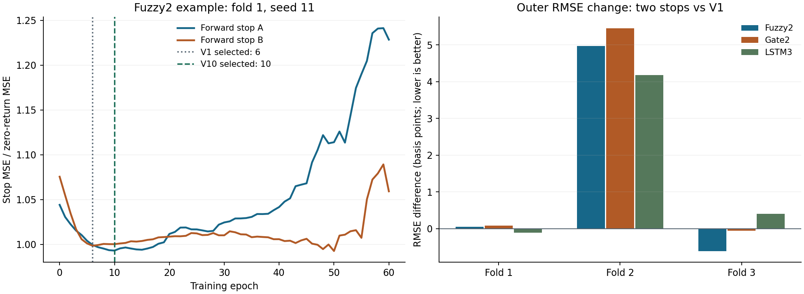

# V10：两个向前停止段能否纠正过早训练轮数选择

**日期：2026-11-05。证据性质：**在已看过 V1—V9 的开发结果后进行的单因素训练选择实验。训练前固定的切段、训练预算、选择公式和门槛见[实验合同](v10_multistop_epoch_contract_2026-11-05.json)。原最终期未参与拟合、选择或新评分；没有独立盲测。

## 要回答的问题与设计

用户提出：先前一些运行选中很早的轮数甚至 epoch 0，是否意味着模型太小或训练不足？本轮**只检验轮数选择**，不更改容量。保留原 20×6 输入、SRT 下一日原始收盘对数收益、收盘后预测时点、原三个外层开发折和种子 11/23/37。Fuzzy2 仍为 LSTM32→`tanh` 三维表示→两条 Gaussian 规则→两个仿射专家；普通 Gate2 和单头 LSTM3 按相同方法作为对照。

每个外层训练集的末尾分出两个**互不重叠、向前排列的 15% 停止段**：A 使用更早的训练前缀，B 是 V1 原来使用的最后 15%。每段的输入与标签标准化只在它前面的拟合前缀完成。每个模型／折／种子／段都完整训练 **150 epoch**，记录 0—150 的训练与停止损失，不按 20 轮耐心提前终止。每个已训练轮数的停止 MSE 除以该段的原始零收益预测 MSE，再平均两个段的比率，选平均值最低的**最早**轮数。epoch 0 只作诊断，正式候选仍是 1—150，与 V1 一致。最后同种子、同原训练器、完整外层训练集重新训练所选轮数，在原外层评价日期计分。

这是一项**训练选择方法扩展**：内部拟合次数与计算量大于 V1。两个内部段的训练样本量和所在时间同时不同，因此它们的最优轮数差异不能单独归因为市场机制。V1 已存模型是相同结构、相同外层重训方法的历史对照。V10 的最新内部段在 V1 原早停范围内复现其训练／停止曲线，最大差约 **2.4×10⁻⁷**（标准化 MSE）；固定第 6 轮的 Fuzzy2 外层重训亦复现 V1 同组逐日预测。

## 训练轮数诊断

| 模型 | V1 最佳轮数中位数 | 两段选择中位数 | 两段选择比 V1 更晚的组数 | 两段各自最佳轮数差的中位数 |
| --- | ---: | ---: | ---: | ---: |
| Fuzzy2 | 3 | **6** | **7/9** | **31** |
| Gate2 | 4 | 6 | 5/9 | 18 |
| LSTM3 | 6 | 9 | 5/9 | 24 |

所以原单停止段**确实可能使轮数选择偏早**：Fuzzy2 的最新 B 段在完整 150 轮中，有 **4/9** 组的最低停止误差落在 V1 的耐心早停结束之后。例如第一折 seed 11，A 段的最佳轮数为 10，B 段为 50，V1 选 6，两段平均后选 10。Fuzzy2 最新 B 段仅 **1/9** 组的 epoch 0 优于所有已训练轮数；“总是随机表示最好”也不是 V1 的一般规律。V5 选到 epoch 0 属于另一种岭回归后件与零回退训练流程，不能与 V1 直接混同。

但更晚的轮数没有带来外层收益。全部 **18 条 Fuzzy2 内部曲线**（9组×2段）中，第 150 轮训练 MSE 均低于第 1 轮，而第 150 轮的停止误差均高于第 1 轮。这支持长时间继续优化训练集会损害时间外泛化，而非原 150 轮上限不够。

## 外层开发期预测比较

先对每种子的 378 个不重复目标日计算 pooled 指标，再平均三个种子；Z0 是确定性参考。

| 方法 | pooled RMSE | pooled MAE |
| --- | ---: | ---: |
| **Z0** | **0.009431** | **0.006290** |
| 原 Gate2 | 0.009456 | 0.006353 |
| 原 LSTM3 | 0.009473 | 0.006387 |
| 原 Fuzzy2 | 0.009489 | 0.006385 |
| 两段选择 LSTM3 | 0.009595 | 0.006527 |
| **两段选择 Fuzzy2** | **0.009599** | **0.006508** |
| 两段选择 Gate2 | 0.009602 | 0.006495 |

两段选择 Fuzzy2 相比原 Fuzzy2 的 RMSE **恶化约 1.17%**，相比 Z0 恶化约 **1.79%**；同折／种子配对仅 **4/9** 优于原 Fuzzy2，折均值仅 **1/3** 优于原 Fuzzy2、**0/3** 优于 Z0。普通门控和 LSTM3 使用完全相同的新选法也都变差，说明这不是 Gaussian 独有的获益。Fuzzy2 的主要恶化发生在第二折：

| 折均 RMSE | 原 Fuzzy2 | 两段选择 Fuzzy2 | Z0 |
| --- | ---: | ---: | ---: |
| 第一折 | 0.009871 | 0.009876 | 0.009828 |
| 第二折 | 0.007286 | **0.007782** | 0.007270 |
| 第三折 | 0.010888 | 0.010827 | **0.010787** |

本轮没有通过固定的 1% 候选门槛，也没有达到项目约 3% 的实质改善资源目标。两者均非老师规定的硬性要求或独立显著性结论。外层结果说明：**早停窗口影响选到的轮数，但把训练推进到更多轮并不能在当前三段已查看的开发期中稳定改善完整模型。**不能据此断言所有更大模型或更小学习率都无效；本轮没有改变这些因素。

## 下一步边界

不建议据本轮把 150 轮上限再提高、扫描更多停止块切点或挑第三折的有利结果当作优化。若要专门检验“容量太小”，需要另立一个只改容量的合同：保持同一输入、输出三维、两条规则和同一时间选择规则，让较小／较大的 LSTM 隐藏维度与 32 匹配比较，并同报 Z0、LSTM3、Gate2。这样的新实验仍会受当前反复使用的开发折选择偏差影响；没有新时期资料就不能当成独立确认。结合 [V9 只读信号诊断](v9_signal_audit_results_2026-11-05_zh.md)，模型容量不足仍是可能解释，但现有证据没有把它提升为最有支持的解释。

**复核资料：**[实现](../src/v10/multistop_epoch.py)、[绘图代码](../src/v10/plot_multistop_epoch.py)、[时间切段与 V1 重训复现测试](../tests/test_v10_multistop_epoch.py)、[完整轮次曲线、预测、逐折指标和来源哈希](../output/v10/multistop_epoch/)。54 次完整内部拟合及 27 次外层重训全部保存结果；没有改写 V1 或 V6—V9 文件。V6—V10 当前均未提交 Git，等待 Ryan 审阅。
