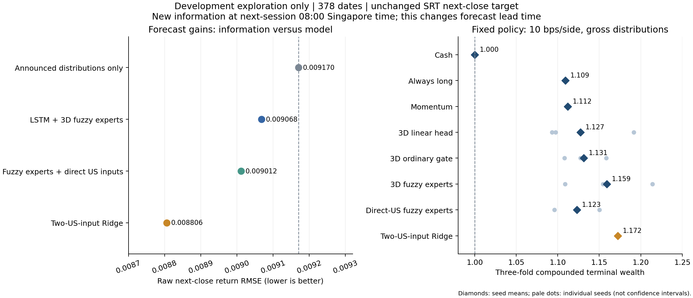

# V4 开盘前信息增强：有效信息与模糊模型贡献的实测

**日期：2026-11-05。**所有新实验仅用原开发日期；这是多轮探索之后的新假设，不是新的独立测试。

## 1. 结论

**找到了一项超出此前微小误差差异的信息改进：次日08:00前可获得的海外市场行情。**同一378个开发日期上，VNQ/SPY两输入 Ridge 相对公告基线的 RMSE 下降 **3.97%**、MAE 下降约 **2.40%**，三个折中两个改善。原收盘口径下的同类海外输入没有带来相同收益。

但**保留神经模糊主结构的方案还没有达到本轮设定的实质预测提升目标**。原三维专家结构的 RMSE 改善1.11%；让专家直接读取两项最新海外变量后改善1.73%，均未超过同信息 Ridge。不能把3.97%全部归功于模糊网络。

固定交易策略的开发期结果也转为正值，但改善集中在第一折、成本敏感，且同信息 Ridge 仍更强。当前适合称为“有证据的额外信息方向＋尚待完善的模糊模型”，不能称已验证的稳定盈利或模糊机制优势。

## 2. 保留与声明的修改

保留 **SRT、下一交易日原始收盘对数收益、20步LSTM32、三维表示、两条Gaussian规则及两个仿射专家**。以下内容必须作为命名扩展声明：

| 项目 | 本轮定义 |
| --- | --- |
| 预测时间 | 原收盘后口径具体化为`t日18:00`；新增口径为下一SRT交易日`08:00`，均为新加坡时间 |
| 新输入 | VNQ和SPY的已完成海外交易收益增量，输入从6列扩为8列 |
| 输入处理 | 原SRT三列使用历史分派总收益校正；STI/SORA仍只用截至`t`收盘的信息，避免同时扩大多个信息来源 |
| 训练 | 沿用H12的训练内潜在坐标归一化、规则聚类初始化、正则化线性后件求解及梯度训练；所有对照统一 |
| 严格结构版本 | Gaussian前件和仿射后件都只读取3维潜在表示；这是预先登记的结构对照 |
| 直接输入版本，预定主候选 | 前件仍只读取3维表示；每个仿射专家另可读取最新2个海外变量。普通线性头/普通门控也获得同样变量 |

缩短预测提前量、增加已知行情本身就可能提升预测。不能将其写成“同一信息集下算法提升”，也没有声称老师已经单独批准V4。V1的冻结实验与文件保持原状。

## 3. 数据和时间核查

### 来源

固定取得VNQ、SPY在 **2021-09-01至2025-09-30** 的Yahoo日线快照，各 **1,024条**，保存请求URL、原始响应、抓取时间与SHA-256。未抓取新最终期来筛选模型。

VNQ作为美国房地产板块代理，SPY作为美国大盘代理；两者都不是SRT标的指数，也没有被当成SRT的延长历史。基金官方资料分别说明其房地产板块和S&P500跟踪目标。[Vanguard VNQ](https://advisors.vanguard.com/investments/products/vnq/vanguard-real-estate-etf)、[State Street SPY](https://www.ssga.com/us/en/intermediary/etfs/state-street-spdr-sp-500-etf-trust-spy)

文件：[VNQ来源清单](../data/source_us_vnq_manifest.json)、[SPY来源清单](../data/source_us_spy_manifest.json)。

### 可得时间是显式假设，不是历史投递日志

每个纽约交易日保守按 **16:00 America/New_York常规收盘＋2小时**作为数据可用时间。提前收市也仍使用16:00，故不会因早收市而提前使用数据。纽约夏令时逐日转换，不使用固定UTC偏移。此处依据公开交易时段构造可用性代理；Yahoo历史快照不含当年的投递日志，不能据此证明当年的具体接口延迟。[NYSE交易时段](https://www.nyse.com/trade/hours-calendars)

新加坡08:00早于08:30开盘前阶段。与原18:00截止口径对比时，最后一个可用的纽约交易日可能不同。[SGX交易时段](https://www.sgx.com/securities/trading)

例如2024-03-11新加坡18:00尚不能使用纽约3月11日收盘，只能看到此前已完成的交易日；到新加坡3月12日08:00，才可使用纽约3月11日收盘。相关边界和夏令时转换都有针对性测试。

海外特征用相邻SRT预测时点已知的总收益指数之差构造：遇到海外休市且没有新交易日，增量为零；跨本地假日累计已完成海外交易的收益。分派只进入其已经发生的历史收益，不使用未来回溯复权价。所有处理是向后as-of匹配，没有未来填补。

完整时间对齐表有两种截止口径×两个来源×970行。另将假定延迟从2小时延长到3小时复核，四组使用的来源交易日均未改变。这支持该小范围延迟敏感性，但不消除历史数据修订和可得性代理的局限。

## 4. 事前固定的实验与结果

### H15：先检验信息是否有用

[信息筛选合同](v4_preopen_screen_contract_2026-11-05.json)固定五种小型输入方案，Ridge只在训练段最后15%选择`λ∈{0.1,1,10}`或零残差，随后外层重拟合。截距也收缩，预测加回相同的已公告分派。

| 方案 | pooled RMSE | pooled MAE | 相对公告基线RMSE |
| --- | ---: | ---: | ---: |
| 公告基线 | 0.009170 | 0.006148 | — |
| 原六输入末端值 | 0.009170 | 0.006148 | 无变化 |
| 18:00的海外两输入 | 0.009170 | 0.006148 | 无变化 |
| **08:00的海外两输入** | **0.008806** | **0.006001** | **改善3.97%** |
| 08:00的全部八个末端输入 | 0.008831 | 0.006010 | 改善3.70% |

三种“无变化”方案都是内层选择零残差的结果，而不是把常数基线伪装成成功拟合。

两输入08:00模型逐折RMSE为 **0.008407 / 0.007253 / 0.010415**，公告基线为 **0.009375 / 0.006846 / 0.010790**。第二折明显更差，因此不能只报告pooled提升而声称所有市场环境均受益。两种08:00配置仍通过预设的两折改善与整体误差门槛，才开始神经比较。

### H16：同信息神经与模糊对照

[神经实验合同](v4_neural_contract_2026-11-05.json)固定 **2个截止口径×2个后件结构×3种头×3折×3种子＝108组运行**。没有搜索新的λ、宽度、学习率或种子。以下神经数字均为每个种子先算pooled指标后取均值。

| 08:00方案 | RMSE | MAE | 相对公告基线RMSE |
| --- | ---: | ---: | ---: |
| **海外两输入Ridge** | **0.008806** | **0.006001** | **改善3.97%** |
| 三维表示→线性头 | 0.009046 | 0.006111 | 改善1.35% |
| 三维表示→普通门控 | 0.009054 | 0.006120 | 改善1.26% |
| **三维表示→Gaussian专家，严格结构版本** | **0.009068** | **0.006169** | **改善1.11%** |
| 后件直接读取海外变量→线性头 | 0.009030 | 0.006082 | 改善1.53% |
| 后件直接读取海外变量→普通门控 | 0.009045 | 0.006086 | 改善1.36% |
| **后件直接读取海外变量→Gaussian专家，主候选** | **0.009012** | **0.006086** | **改善1.73%** |

主候选只在一个折的种子平均RMSE上严格胜过公告基线，另一个折退回基线；它只在4/9个配对中胜过对应普通头。相对Ridge，其RMSE还差 **2.33%**。严格结构版本虽在两个折改善，但MAE略差于公告基线，也未超过同信息普通头。

因此两种模糊版本都**没有通过预先固定的3%流程目标或1%模糊增量目标**。不能因为某个交易汇总更好，就事后将另一个配置重新指定为主候选。

结果：[预测比较](../output/v4/neural_preopen/comparison_pooled.csv)、[逐折比较](../output/v4/neural_preopen/comparison_by_fold.csv)、[判定记录](../output/v4/neural_preopen/decision.json)。

## 5. 固定交易规则的应用诊断

使用原有未调参规则：预测大于零则持有，否则现金；在下一可观察开盘调整仓位，沿用分派权益和现金到账记账，并在每折已知边界平仓。没有根据新收益搜索阈值或选择种子。

新增08:00预测有真实时点检查，确保它早于当天名义09:00开盘；导出的主候选账本区分原始特征结束日期和实际预测时间。对比都是同一开发期、相同开盘、相同交易规则与成本。

### 含分派、每边10 bps成本

先将每个种子的三个折末财富相乘，再对种子取均值；它是开发期分折策略的复合结果，不是年化收益。

| 策略 | 三折复合末财富 | 累计收益 |
| --- | ---: | ---: |
| 现金／公告基线信号 | 1.000000 | 0.00% |
| 始终持有 | 1.109238 | 10.92% |
| 历史动量 | 1.111929 | 11.19% |
| 08:00三维表示普通线性头 | 1.127259 | 12.73% |
| 08:00三维表示普通门控 | 1.131239 | 13.12% |
| **08:00严格结构Gaussian** | **1.159182** | **15.92%** |
| 08:00直接海外输入Gaussian | 1.123011 | 12.30% |
| 08:00直接海外输入普通线性头 | 1.091407 | 9.14% |
| 08:00直接海外输入普通门控 | 1.094448 | 9.44% |
| **08:00海外两输入Ridge** | **1.172391** | **17.24%** |

严格结构Gaussian相对动量多 **4.73个百分点**的累计收益，相对同信息三维线性头和普通门控分别多 **3.19和2.79个百分点**，是值得保留的开发观察。但它三折的种子平均末财富为 **1.1953 / 0.9367 / 1.0364**，只在第一折超过动量。三种子的复合财富为 **1.1087 / 1.1546 / 1.2142**，也有明显差异。不能把汇总优势说成跨时期稳定优势，也不能替代预测误差中的普通头对照。

### 成本敏感性

严格结构Gaussian在**不含分派**的价格财富口径下，0/10/20 bps每边成本对应末财富 **1.2685 / 1.1248 / 0.9980**。成本提高后接近零收益，显示换仓成本非常重要。这一列不能与含分派口径混用。

交易评价是对已保存预测的固定策略应用诊断，不是新预注册的交易选模。当前没有独立时期或真实执行证据，不能据此声称已找到稳定盈利策略。

结果：[逐折财富](../output/v4/neural_preopen/portfolio_by_fold.csv)、[各种子复合财富](../output/v4/neural_preopen/portfolio_by_seed.csv)、[主候选账本](../output/v4/neural_preopen/primary_gross_10bps_ledger.csv)。

## 6. “显著”应如何表述

补做了事后的配对平方误差分块bootstrap：每折内部循环块，块长5/10/20，各5,000次；神经种子先按日期平均损失，没有当成额外独立市场样本。

- Ridge相对公告基线，在三个块长下的95%差异区间都低于零。块长10时约为 **[−1.294×10⁻⁵，−7.436×10⁻⁷]**，支持其在这段开发数据上的信息增益。
- 两个Gaussian版本相对公告基线，在三个块长下的区间均跨零；没有同样强的证据。
- 主Gaussian版本相对Ridge，区间反而都高于零，支持Ridge在当前数据上的优势。

这些检验在看到多轮开发结果后增加，**没有校正整个研究过程的多重尝试和选模偏差**。因此不能当成预注册独立测试的显著性结论。有效的表述是“开发期信息增益得到描述性统计支持，模糊模型自身的显著优势尚未建立”。

证据：[分块区间](../output/v4/neural_preopen/exploratory_block_intervals.csv)、[独立复算与时间敏感性](../output/v4/neural_preopen/independent_audit.json)。

## 7. 当时的后续建议与当前定位

**当前定位：V4保留为信息增强支线，不作为模型优化成果或当前执行主线。**用户要求固定原数据、原预测时点和原目标研究模型改进；最新方案见[模型优化指导第0节](improvement_hypotheses_2026-11-04_zh.md)。以下海外共同线性项是V4当时的未实施设想，不等同于已完成的V5，也不是目前推荐的下一实验。

V4当时停止了这一轮模型矩阵，并提出研究“为什么神经模糊模型没有充分利用一个小线性模型已经能利用的海外信号”。

当时设想的改动是：让两个仿射专家共享一个训练内估计的海外线性项，只让模糊部分学习条件修正：

```text
expert_k = common_US_linear_term + local_correction_k(z)
prediction = announced_distribution + sum_k alpha_k * expert_k
```

前件仍是3维LSTM表示，后件仍是仿射专家。这可以减少重新学习共同线性信号的负担，但必须与相同共同线性项的非模糊修正对照。共同项、缩放、修正模型均只能用各层训练数据拟合；若修正为零，结果只是退回Ridge，**不能宣称模糊层贡献**。本轮没有实施这个新假设，也没有把它当作保证成功的办法。

在正式提交中，应把三件事清楚分开：原方案的冻结基准；本轮明确改变预测时点和外部输入的开发探索；模糊模型尚未超过强线性参考的限制。若正式采用08:00扩展作为主成果，应在课程文书中声明时间、输入、训练及后件改动，并按课程对proposal修改的要求处理。

## 8. 产物和核验

- 海外来源、时间对齐、H15合同与筛选、H16合同与108组神经运行均已保存。
- **50项测试通过**；原V1冻结预测和财富核验仍通过。
- H16执行依赖哈希和逐运行输出哈希核验通过，36组Gaussian诊断恒等式核验通过。
- 独立复算16,254行含对照的预测记录，汇总指标最大差约 **6.59×10⁻¹⁷**。
- 未使用原最终期给新模型排名，未提交Git，也未重建旧最终Notebook/slides/交接包。



复核入口（使用项目Python环境；分析脚本只读取预测并重建派生汇总，不重新训练）：

```powershell
python -m src.v4.analyze_preopen
python -m src.v4.audit_improvement
python -m src.v4.plot_results
python -m unittest discover -s tests -v
python -m src.tools.verify_final_outputs
```

图表同时保存为[PNG](../output/v4/neural_preopen/development_summary.png)和[PDF](../output/v4/neural_preopen/development_summary.pdf)。
