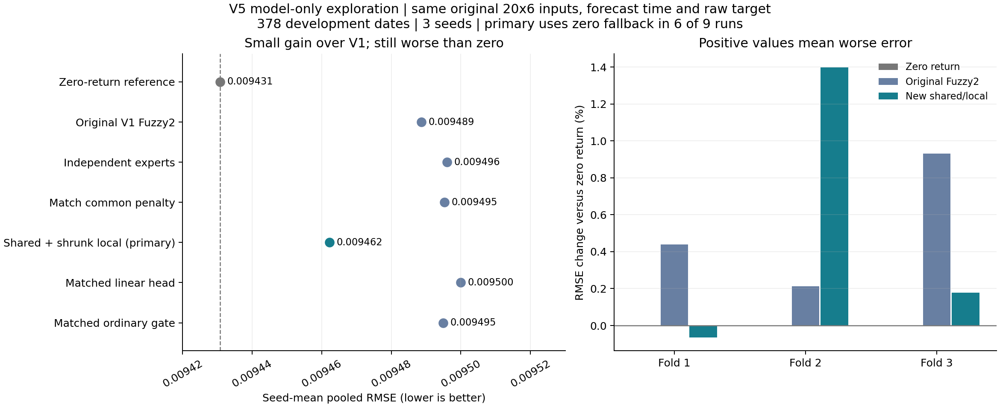

# V5：固定原数据的共享预测与局部专家优化

**2026-11-05。本轮按用户纠正后的目标，只研究模型和训练改进。**此前V4的海外行情和08:00时点收益属于信息增强，不作为本轮模型优化成果。本轮没有新独立测试，仍是多轮研究后的开发探索。

## 1. 结果先行

已完成 **5配置×3折×3种子＝45组运行**。共享预测＋收缩局部修正的主候选，相对原Fuzzy2的RMSE降低 **0.28%**、MAE降低 **0.77%**，但相对零收益预测的RMSE反而高 **0.33%**。没有达到明显提升目标，也没有达到预设1%的候选门槛。

这次确实是相同信息下的模型/训练实验，但**改了模型，不等于已经取得有效优化**。修正惩罚不匹配本身几乎没有收益；较强的局部分支收缩减少了部分有害预测，仍没有建立稳定的专家分工。

## 2. 固定了什么、修改了什么

| 项目 | 处理 |
| --- | --- |
| 数据与时点 | 原保存的20×6窗口，逐元素检查一致；仍在原收盘后预测；没有海外变量、额外历史或新的可得信息 |
| 目标 | 原始下一日收盘对数收益，逐元素检查一致；没有分派残差标签或公告预测偏移 |
| 核心结构 | LSTM32→tanh三维表示→两条Gaussian规则→两个仿射专家，保留 |
| 日期与种子 | 原三个开发折、378个评价日期、种子11/23/37；原最终期不生成新预测或排名 |
| 本轮关键修改 | 两个独立仿射专家改写为共同部分＋正负局部修正，并分别控制两部分惩罚 |
| 五配置共同训练 | 沿用H12训练内潜在坐标归一化、训练内聚类初始化、正宽度参数化、可微正则最小二乘后件；全批AdamW训练 |
| 缩放与选择 | 原标签仅除以训练标准差，不减均值，使零输出对应原始零收益；内层时间序列早停和显式零预测回退 |

最后两行是**相对V1的训练扩展**，不是声称只换了变量名字。因此，主候选相对V1的差异代表整个训练方案的差异；V5内部消融才隔离共同惩罚与局部惩罚的效果。核心结构的既有批准不代表老师已单独批准所有新训练细节，正式方法说明需逐项声明。

## 3. 数学修改与归因

设`q=[z1,z2,z3,1]`，规则权重为`α1+α2=1`：

```text
原模型：e1=q·β1，e2=q·β2，ŷ=α1e1+α2e2
改写后：e1=q·(b+d)，e2=q·(b−d)
        ŷ=q·b+(α1−α2)q·d
```

两种写法的表达能力完全相同，总后件系数仍为8个，没有向专家绕过三维表示输送原始输入。区别在于正则化：

```text
λ(||β1||²+||β2||²)=2λ||b||²+2λ||d||²
```

原先“单头和双专家都用λ=0.1”并不意味着共同预测部分受同等惩罚；双专家等价于共同/差异部分各0.2。这是先验约束强度不同，**不是原代码算错了损失**。改写后可以只放松共同部分、单独收缩差异部分。

数值测试验证：惩罚按等价关系转换时，独立/共享形式的预测、目标值及对表示和权重的梯度均相同。因此等价改写没有被计作一次独立胜利。

执行前合同：[V5固定实验合同](v5_model_only_contract_2026-11-05.json)。

| 配置 | 共同部分惩罚 | 局部差异惩罚 | 作用 |
| --- | ---: | ---: | --- |
| 同训练线性头 | 0.1 | 无局部分支 | 对照共同表示/训练的收益 |
| Gaussian独立专家 | 等价0.2 | 等价0.2 | 后件原独立形式，各λ=0.1 |
| Gaussian共同惩罚匹配 | 0.1 | 0.2 | 只改变共同部分惩罚 |
| **Gaussian共享＋局部收缩，主候选** | **0.1** | **1.0** | 再只加强差异约束 |
| 普通门控共享＋局部收缩 | 0.1 | 1.0 | 区分Gaussian与普通门控 |

λ以平均平方误差定义，包含截距，全部在拟合前固定，没有看结果再挑选λ或种子。原Gaussian中心/宽度的初始化在三个Gaussian消融中一致。

## 4. 同日期预测比较

神经模型先按种子计算378日期的pooled误差，再对三个种子求均值，不是平均预测的集成结果。

| 方案 | RMSE | MAE |
| --- | ---: | ---: |
| **零收益Z0** | **0.009431** | **0.006290** |
| 训练均值 | 0.009444 | 0.006328 |
| 原V1普通门控 | 0.009456 | 0.006353 |
| **V5共享＋局部收缩，主候选** | **0.009462** | **0.006336** |
| 原V1三维线性头 | 0.009473 | 0.006387 |
| 原V1 Fuzzy2 | 0.009489 | 0.006385 |
| V5普通门控共享＋局部收缩 | 0.009495 | 0.006364 |
| V5共同惩罚匹配 | 0.009495 | 0.006360 |
| V5独立专家 | 0.009496 | 0.006359 |
| V5同训练线性头 | 0.009500 | 0.006376 |
| 原V1 LSTM32 | 0.009624 | 0.006518 |
| 原六输入展平Ridge | 0.009956 | 0.007007 |

主候选比原LSTM32好1.68%、比原Ridge好4.96%，但这两个较弱参考不能代替Z0、原Fuzzy2和三维线性头。相对原Fuzzy2仅改善0.28%；相对同训练线性头改善0.40%，相对同训练普通门控改善0.34%，都未达到候选门槛。

| 三折种子平均RMSE | 第一折 | 第二折 | 第三折 |
| --- | ---: | ---: | ---: |
| Z0 | 0.009828 | 0.007270 | 0.010787 |
| 原Fuzzy2 | 0.009871 | 0.007286 | 0.010888 |
| V5主候选 | 0.009822 | 0.007372 | 0.010806 |

主候选只在第一折超过Z0；相对原Fuzzy2改善两个折、7/9个配对，但幅度太小。合同中的3%实质目标、1%候选门槛是本项目资源判断标准，**不是老师规定，也不等于统计显著性**。整个模型的提升与Gaussian独有贡献分开判断，本轮两者均未建立。

结果：[完整比较](../output/v5/shared_local/comparison_pooled.csv)、[逐折逐种子](../output/v5/shared_local/comparison_by_fold.csv)、[判定](../output/v5/shared_local/decision.json)。

## 5. 消融解释：约束起效了，但局部预测没有稳定受益

**单独修正共同惩罚，RMSE仅改善0.0077%。**这不支持此前“惩罚不匹配可能是主要瓶颈”的强猜测。它值得澄清，但不是本次表现差的充分解释。

**再加强局部惩罚，相对共同惩罚匹配版本改善0.35%。**三个Gaussian配置均为6/9组零预测回退，且回退位置相同，因此这一差异不是通过多选几次零预测获得的。它来自剩余三个非回退模型的预测变化；三组均改善，其余六组是相同零预测，不能称9/9胜出。

仅在非回退运行中，对每组先计算分支RMS再平均：局部项由约 **0.001030降至0.000461**，专家平均绝对差由约 **0.001832降至0.000778**；平均最大规则权重约0.92，前件已相当明确。收缩主要压低不稳定的专家差异，不是让模糊权重更加分离。

主候选仍有 **6/9组回退**；三个被采用的模型中两个选中epoch 0，即随机初始化表示＋拟合后件，只有一个选中更新后的编码器（3个epoch）。这说明本次训练与内层选择尚未反复选出有价值的表示更新；不等于已证明LSTM表示无法改进。

保持已拟合共同项不变、诊断性移除局部项，pooled RMSE约为 **0.009449**，反而低于完整模型的0.009462，但仍差于Z0。这是**事后组件诊断**，没有将该版本改选为主模型，也没有把它当作重新训练的公平单头对照。完整模型只在一个非回退折受益于加入局部项，另两个折变差。

三个非回退运行共六个训练上四分位激活区域中，两个区域只有10和3个评价样本，不能支持专家命名。其余四个区域仅一个出现激活专家的MAE优于另一专家，没有重复的局部专长证据。

另保存了不使用零回退的拟合预测，其主候选pooled RMSE约0.009457，仍差于Z0；这不改变内层固定选择，也不能据外层结果删除回退规则。

证据：[分支诊断](../output/v5/shared_local/component_diagnostics.csv)、[局部区域误差](../output/v5/shared_local/local_regions.csv)、[机制汇总](../output/v5/shared_local/mechanism.csv)。含回退运行的权重只是前件状态，不能当成被采用的专家贡献。

## 6. 不确定性与停止判断

按合同执行配对平方误差分块bootstrap：每折内循环块、长度5/10/20、各5,000次，先按日期平均种子损失，不把种子当独立市场样本。

主候选相对原Fuzzy2、Z0、同训练线性头及普通门控，在三个块长下95%差异区间都跨零。块长10时，相对原Fuzzy2约 **[−1.560×10⁻⁶，5.111×10⁻⁷]**，相对Z0约 **[−1.066×10⁻⁷，1.487×10⁻⁶]**。

相对两个Gaussian消融配置的区间均低于零，支持本次更强局部收缩的方向；但幅度仍小，而且这些方法共享多轮开发历史。这不是独立验证的显著性证明，也没有校正整个研究过程的多重尝试。

**本轮结束该惩罚组合，不扩大λ扫描、不换数据来制造提升。**保留代码与全部失败结果，作为“相同信息下，后件正则化能够减少部分误差，但未形成实质预测收益”的证据。

**后续指导更新：**结合之后对训练曲线与时间变化的只读分析，优先级调整为先验证表征学习，再验证分阶段专家训练；与任务相关的状态约束前件作为后续结构假设，并配套时间验证。详见[模型优化指导第0节](improvement_hypotheses_2026-11-04_zh.md)中的旧建议对照、最小实验与停止条件。

V5的共享/局部参数化仍是联合训练，不等于已经测试分阶段训练。先训练共同预测、再冻结共同部分学习局部修正，仍是未实施的假设；需要与同样分阶段的普通门控匹配比较。新的辅助表征训练只使用原训练窗口，不复用V4海外输入或公告偏移。本次只更新后续指导，不改写上述V5结果，也不启动新训练。

## 7. 代码、验证与课程产物边界

- 实现：[shared_local.py](../src/v5/shared_local.py)；比较与核验：[analyze_shared_local.py](../src/v5/analyze_shared_local.py)。全部新增在V5目录，未改动冻结模型和旧实验源码。
- **56项测试通过**，新增6项覆盖参数化等价的预测/损失/梯度、双倍惩罚、局部收缩、原数据一致性、未来隔离和可训练路径。
- 45组依赖/输出哈希核验通过；27组Gaussian预测/case/rule恒等式核验通过；共同项＋局部项与预测的最大差约 **2.80×10⁻¹⁰**。
- 对含参考模型的11,340条预测记录另行复算，汇总指标最大差约 **6.07×10⁻¹⁷**。
- 原V1冻结预测与财富核验通过。本轮没有重新评价原最终期，没有改写Notebook、slides或交接包，也没有创建Git提交。
- 已有课程核心方案保持；本轮训练细节和探索性质必须在正式采用时声明，不能以这轮结果替换原预注册测试结论。



复核已有结果，不重新训练：

```powershell
python -m src.v5.analyze_shared_local
python -m src.v5.plot_results
python -m unittest discover -s tests -v
python -m src.tools.verify_final_outputs
```

本机已验证解释器为`E:/Environment/Anaconda3/envs/env_cuda/python.exe`。训练入口`python -m src.v5.shared_local`拒绝覆盖现有实验目录。图表同时保存为[PNG](../output/v5/shared_local/model_only_summary.png)和[PDF](../output/v5/shared_local/model_only_summary.pdf)。

供后续审阅的提交说明建议：`experiment: evaluate model-only shared/local fuzzy experts`。本轮改动范围为`src/v5/`、`tests/test_v5_shared_local.py`、V5合同/报告、`output/v5/`和文档索引；此前V3/V4未提交文件不混入该阶段提交。
