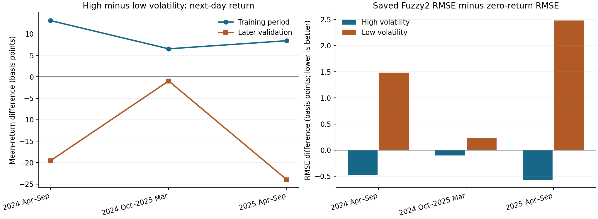

# V9：原六输入的时间稳定性与专家分工只读诊断

**日期：2026-11-05。性质：**在 V1—V8 结果已查看后做的描述性开发期分析。计算前固定的变量、分组和输出见[诊断合同](v9_signal_audit_contract_2026-11-05.json)。本轮**没有训练或调参任何新模型**，只读取原始窗口、三个开发折，以及 V1/V7 已保存的预测与专家输出；原最终期没有进入计算。

## 核查口径

- 六项原输入都取 20 日窗口**最后一个历史日**的已知数值，分别计算与下一日原始 SRT 收盘对数收益的训练／随后评价 Pearson、Spearman 关联。
- 每一折仅按该折训练期中位数把每项特征分成高／低两组，比较两组下一日平均收益；评价期使用同一个训练阈值。
- 单独用原输入第 3 列的 SRT 20 日历史波动率划分状态，核查收益均值、波动及 SRT 五日动量、STI 当日收益与目标的分状态关联。
- 在同一训练阈值划出的评价日上，重算**已保存**的 Z0、原 V1 Fuzzy2、V7 Gaussian 误差。对 V7 四组内层接受非零局部项的运行，以固定规则权重 `α ≥ 0.8` 检查激活专家与另一专家的 MAE；不足 20 日的区域只作小样本描述。

最后一日的单变量关系只是探针，**不能给整个 20×6 非线性输入的信息量设上界**。三个开发折已经反复用于研究，也不能把本轮的稳定符号或差异当作独立显著性检验。

## 六项特征：可见关联没有跨时间稳定复现

训练期每个折的六项“最后一日特征—次日收益”Pearson 绝对值均不超过约 **0.074**。评价期有个别绝对值达到约 0.17—0.18，但符号会变：

| 最后一日特征 | 三个训练折 Pearson（约） | 后续三个评价折 Pearson（约） |
| --- | --- | --- |
| SRT 当日收益 | +0.002 / +0.015 / +0.021 | +0.063 / +0.065 / −0.117 |
| SRT 五日动量 | −0.003 / −0.001 / +0.003 | −0.013 / +0.027 / −0.001 |
| SRT 20 日波动率 | +0.074 / +0.044 / +0.046 | −0.088 / −0.012 / +0.051 |
| STI 当日收益 | +0.024 / +0.037 / +0.015 | +0.080 / −0.171 / +0.174 |
| 最新 SORA 水平 | +0.001 / +0.012 / +0.004 | −0.004 / −0.182 / −0.065 |
| SORA 20 次公布变化 | −0.009 / −0.010 / −0.008 | +0.035 / −0.044 / −0.082 |

没有一项特征在**三个折都保持训练与评价 Pearson 同号**。SORA 水平的评价期 Pearson 三折均为负，但训练期几乎为零且略为正；其评价期 Spearman 也不是三折同号，因此不应把它选为已证实的负向信号。每项训练中位数高低分组的收益差也没有在三个折保持训练／评价同号。尤其第三折评价期的 SORA 水平 **128/128 天都低于训练中位数**；第二折高于中位数的仅 6/124 天。这说明该二分法在后来时段出现了覆盖变化。

这与先前 H1 的读取结果一致：同数据的强正则 Ridge 开发期 RMSE **0.009956**，差于 Z0 的 **0.009431**；不过 H1 仅检查了固定正则网格，不能据此证明不存在任何复杂或非线性关系。

## 波动状态：训练与评价的平均收益关系反向

把“高波动组下一日平均收益减低波动组”换算成基点，三个训练折约为 **+13.1、+6.5、+8.4 bp**，随后评价折约为 **−19.5、−1.0、−24.0 bp**。评价期高波动组分别有 **68、31、27** 个独特交易日；在第二、三折不构成大样本。SRT 五日动量和 STI 当日收益在高低波动组内的收益相关方向也随折变化，未出现同一特征在同一状态下反复保持训练与随后评价的关系。

## 已存模型：高波动的微小优势不足以证明双专家有效

按同一训练阈值重算保存的 V1 Fuzzy2：在高波动评价日，它的**折内种子平均** RMSE 三折均略低于 Z0，分别低约 **0.48、0.10、0.57 bp**；在低波动日三折均更差，分别高约 **1.48、0.23、2.48 bp**。高波动区按折／种子单独比较只赢 **5/9**，低波动区赢 **1/9**。全体日期仍由 Z0 胜出。

高波动评价组三折的实际平均收益均为负，原 Fuzzy2 预测也整体偏负。因此这项小优势**可能部分来自预测偏置与评价时期均值碰巧吻合**，不能单凭它证明 Gaussian 前件识别了有效市场机制。[单列的事后敏感性检查](../output/v9/signal_audit/posthoc_event_sensitivity.csv)显示：剔除除息目标日后，第一折高波动的小优势明显缩小，但另外两折高波动结论不靠除息日；这项检查只用于解释，不能作为新的选模口径。

V7 的四组非零局部运行中，以 `α ≥ 0.8` 定义的每条规则各有 **3 个至少 20 日**的评价区域；两条规则各在其中 **2/3** 个区域比另一专家 MAE 低，但**没有一组运行同时满足两条规则各自在足量区域获胜**。V7 Gaussian 完整预测在九组中对同训练共同模型 **0/9 获胜**。因此目前没有重复的双向局部专长证据；局部区域个别 MAE 较低也不足以推翻完整模型的负结果。

## 决定与后续含义

本轮没有观察到可直接支持“原六特征的简单关系在不同时段稳定预测次日原始收益”的证据，也没有确认双规则产生稳定互补的专家分工。**不能据此断言六特征完全没有预测信息。**它说明继续围绕同一批开发折调规则数、状态阈值和辅助权重的依据很弱。

下一步如仍保留原方案，较有价值的是**对原 Fuzzy2、普通门控和单头模型统一实施多个向前停止段**，单独检验早停选择的时间不稳定性；评价仍需与 Z0 和同训练对照比较。此诊断不会凭空创造输入信号，结果也仍属于已反复查看的开发期证据。若统一时间选择后仍未改善，应和 Destin 讨论是否接受如实的负结果，或把新增信息／目标调整明确列成另一条方案；真正确认新方案需要未参与选择的新时期数据。

**复核文件：**[只读分析代码](../src/v9/signal_audit.py)、[绘图代码](../src/v9/plot_signal_audit.py)、[事后敏感性代码](../src/v9/posthoc_sensitivity.py)、[完整 CSV、图和来源哈希](../output/v9/signal_audit/)。前述 V1/V7 文件均未改写；V6—V9 尚未提交 Git，等待 Ryan 审阅。
